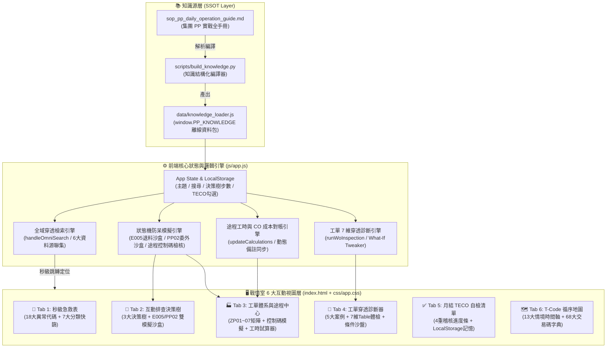
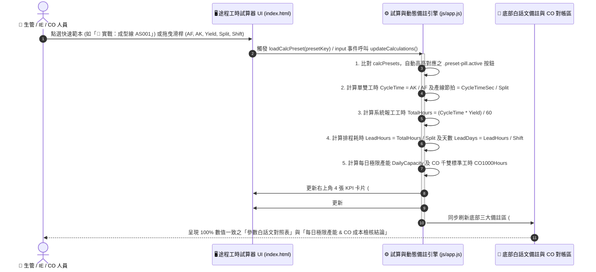

# ⚡ SAP PP 上線戰情排查互動系統 — 網站使用說明書與 SA 功能規格書

> **線上預覽網址 (GitHub Pages)**：[https://tobby0306.github.io/SAP_PP_Web/](https://tobby0306.github.io/SAP_PP_Web/)  
> **系統定位**：集團鞋業 SAP S/4HANA Fashion (PP 生產規劃模組) 一線生管、KU (Key User) 與跨部門現場異常排查之 **零後端離線可攜式互動戰情室 (Zero-Backend Interactive Triage Suite)**  
> **文件遵循規範**：[`.agent/02_role_sa.md`](.agent/02_role_sa.md) 資深系統分析師 (SA) 標準規格模板 + 一線實戰操作手冊

---

## 📑 目錄 (Table of Contents)

1. [第一部分：一線人員網站操作使用說明書 (User Guide)](#-第一部分一線人員網站操作使用說明書-user-guide)
   - [0. 快速啟動與頂部全域工具列](#0-快速啟動與頂部全域工具列)
   - [分頁 1：🚨 秒級急救表 (18 大高頻報錯快篩)](#分頁-1-秒級急救表-18-大高頻報錯快篩)
   - [分頁 2：🌳 互動排查決策樹與防呆模擬沙盒 (E005 & 委外 PP02)](#分頁-2-互動排查決策樹與防呆模擬沙盒-e005--委外-pp02)
   - [分頁 3：🏭 工單體系與途程試算中心 (ZP01~07 & 途程工時/CO成本試算器)](#分頁-3-工單體系與途程試算中心-zp0107--途程工時co成本試算器)
   - [分頁 4：🔬 工單穿透診斷器 (7 維底層資料表體檢)](#分頁-4-工單穿透診斷器-7-維底層資料表體檢)
   - [分頁 5：✅ 月結 TECO 自檢清單 (進度自動保存)](#分頁-5-月結-teco-自檢清單-進度自動保存)
   - [分頁 6：🗺️ 業務情境 T-Code 循序地圖 (13 大情境 & 68 大字典)](#分頁-6-業務情境-t-code-循序地圖-13-大情境--68-大字典)
2. [第二部分：SA 系統分析與功能規格書 (`@02_role_sa.md`)](#-第二部分sa-系統分析與功能規格書-02_role_samd)
   - [1. 功能概述 (Overview)](#1-功能概述-overview)
   - [2. 商業邏輯與驗證規則 (Business Logic & Rules)](#2-商業邏輯與驗證規則-business-logic--rules)
   - [3. 資料庫 / 欄位對應表 (CRUD / Data Mapping Table)](#3-資料庫--欄位對應表-crud--data-mapping-table)
   - [4. 系統流程圖 (Mermaid Architecture & Sequence Diagrams)](#4-系統流程圖-mermaid-architecture--sequence-diagrams)

---

# 📖 第一部分：一線人員網站操作使用說明書 (User Guide)

### 0. 快速啟動與頂部全域工具列

本網站採 **Zero-Backend（無需安裝資料庫或伺服器）** 設計，共有兩種開啟方式：
1. **雲端直接開啟**：瀏覽器開啟 [https://tobby0306.github.io/SAP_PP_Web/](https://tobby0306.github.io/SAP_PP_Web/)。
2. **工廠內網 / 離線電腦開啟**：直接雙擊專案資料夾中的 `index.html`，即可在無外網環境下 100% 正常運作。

#### 🔍 頂部三大神器：
| 功能區域 | 操作方式 | 實戰用途 |
| :--- | :--- | :--- |
| **全站穿透搜尋列 (Omni-Search)** | 按鍵盤快捷鍵 **`/`** 或 **`Ctrl + K`** 直接聚焦輸入（按 `Esc` 關閉下拉選單）。 | 輸入任何關鍵字（如 `E005`、`ZPP020`、`541`、`委外`、`九宮格`），下拉選單會同時跨 **急救表、13大情境、68大交易碼、決策樹、工單類型、穿透診斷器** 顯示結果，點擊即可秒級跳轉至該分頁並自動高亮！ |
| **深淺主題切換鈕** | 點擊右上角 **`☀️ 亮色 Fiori`** / **`🌙 暗色 HUD`**。 | 辦公室大螢幕投影或亮光環境可切為「亮色 Fiori」；個人排查可切為「深色戰情 HUD」。系統會自動記憶您的偏好。 |
| **T-Code 一鍵複製** | 點擊頂部 `📋 COOIS`、`📋 COGI` 或全站任何帶 `📋` 的交易碼標籤。 | 自動將交易碼複製到電腦剪貼簿，直接切回 SAP GUI 按 `Ctrl + V` 即可執行。 |

---

### 分頁 1：`🚨 秒級急救表` (18 大高頻報錯快篩)

**適用時機**：現場人員截圖報錯、單據刪不掉、材料發不出來、自動入庫失效時的第一線秒級排障。

* **頂部「三大最高頻核心雷區」橫幅**（進站即提示上線最常踩雷的三件事）：
  * ① **`E005` 領料後改單**：嚴禁進 `CO02` 改元件！必走 `ZPP024` 開退料單 ➔ 倉管 `ZMM047` (262) 退料歸零 ➔ 再用 `ZPP010` 改單。
  * ② **領料單無法刪除 (狀態鎖定)**：請倉庫先去 `ZMM046` 取消備料單，解除 `ZMMT046` 狀態 `I / M` 鎖定後即可作廢。
  * ③ **自動入庫失效 (途程控制碼)**：工單末站控制碼必為 `PP03` 或 `PP08`，且整張工單**只能放一次**！
* **雙重快篩工具列**：
  1. **關鍵字快篩框**：輸入錯誤碼（`E001`~`E023`）、交易碼（如 `ZPP010`）或現象（如 `備料單`、`退料`）。
  2. **急救類別膠囊按鈕**：可快速切換 `全部 (18)`、`💥 阻擋/致命 (Critical)`、`工序委外`、`開單與轉單`、`領料與發料`、`退料與改單`、`報工與入庫`。
* **急救卡片結構**：
  * ① **觸發交易碼 (點擊可複製)** 與 **根本原因剖析**
  * ② **Step 1 ➔ Step 2 ➔ Step 3 標準排障步驟**
  * ③ **🚫 絕對禁忌動作 (紅框警示)** 與 **👤 跨部門責任單位 (RACI)**

---

### 分頁 2：`🌳 互動排查決策樹與防呆模擬沙盒` (E005 & 委外 PP02)

**適用時機**：遇到跨模組疑難雜症（如 MRP 跑不出計畫單、ECN 改單被卡、委外收貨失敗），不知道該找哪個部門或哪個欄位出問題時，跟著問答一步步抓出真兇。

本分頁上方提供 **5 大互動工具切換鈕**：

1. **🔍 1. MRP 跑不出資料六步標準排查樹 (`VA03 ➔ C223`)**：
   * 採「互動問答精靈 (Wizard)」設計：從 `Step 1 (VA03 訂單檢核)` ➔ `Step 2 (MM03 MRP視圖)` ➔ `Step 3 (CS03 九宮格BOM)` ➔ `Step 4 (CA03 途程)` ➔ `Step 5 (C223 生產版本)` ➔ `Step 6 (MD04/MD01N)`。
   * 您只要根據手邊 SAP 畫面點選「正常通過」或「異常狀況」，系統會自動推進下一步或立即給出 **🛑 排查結論與責任指派**。
2. **🔄 2. 現場退料與元件抽換防呆鏈條 (解鎖 `E005`)**：引导生管與倉管完成標準退料改單閉環。
3. **📦 3. SIT-626 業務訂單挪單生管因應處置流程**：指導訂單取消或挪單時，已發料/未發料工單之標準拆單與轉移步驟。
4. **🧪 4. 現場退料與 ECN 改單防呆模擬沙盒 (`E005` 解鎖沙盤)**：
   * **步驟 1（左側上方）**：切換 5 種工單實體狀態（`🔴 已領料 RESB-ENMNG>0`、`🟢 尚未發料`、`🔒 備料單處理中 ZMMT046 I/M`、`🏁 已 TECO`、`👻 虛擬階 SOBSL=50`）。
   * **步驟 2（左側下方）**：點擊 5 種現場人員動作（如嘗試進 `CO02` 改單、直接刪元件、刪除 `ZPP020`、混退料、或執行標準三步閉環）。
   * **右側模擬終端機**：即時模擬 SAP GUI 狀態列報錯訊息、底層資料表鎖定原因與正確解鎖 SOP，下方並附有「第 5.2 節三大死穴禁忌卡片」。
5. **🤝 5. 製程委外 (`PP02 / 541 / 543`) 防呆模擬沙盒 (委外閉環沙盤)**：
   * 自由切換 5 種委外狀態（標準合規、缺 `ME11` 資訊記錄、未 `REL` 釋放、漏過帳 `541`、委外庫存不足）× 6 種實戰操作，即時預覽為何不能在 `CO11N` 手動報工 `PP02`、以及缺 `541` 時 `MIGO 101` 為何會觸發 `543` 倒扣失敗。

---

### 分頁 3：`🏭 工單體系與途程試算中心` (ZP01~07 & 途程工時/CO成本試算器)

**適用時機**：查詢集團工單類型規範、檢查途程控制碼配置是否違規、試算途程標準工時與排程天數、以及 **與 CO 財務核對 `CK40N` 產品工費成本為何過高**。

本分頁內建 **4 大實驗室子分頁**：

| 子工具名稱 | 操作方式與核心功能 |
| :--- | :--- |
| **📊 1. ZP01~07 與 8 大控制碼矩陣表** | 完整對照 `ZP01~ZP07` 七大工單的開單 T-Code、領料單類別、MES 派工、SAP 報工、自動入庫與成本規則；以及 `PP01~PP08, PP99` 控制碼行為與虛擬階 (`SOBSL=50`) 防呆法則。 |
| **⛓️ 2. 途程控制碼連動模擬器** | 畫面呈現 `Op 10` ~ `Op 50` 五道產線工序卡片，您可自由下拉切換每站的控制碼。系統會即時進行防呆檢測：若您把 **`PP03/PP07/PP08`（自動入庫）放在非最後一站，或整張工單放超過 1 次**，下方會立即跳出紅色違規阻擋警報！ |
| **🎯 3. 工單類型情境智能推薦器** | 點選現場遇到的 9 大生產情境卡片（如「開發樣試做」、「首單大貨量產」、「正單未入庫個別補料」、「入庫後 B/C 品成套重做」），系統秒級推薦應開立之工單類型（如區分 `ZP03` vs `ZP05`）與防呆鐵律。 |
| **🧮 4. 途程工時與排程產能試算器** | **【生管 × CO 對帳神器】** 1. **右上角 4 大快速範本**：點擊 `👞 慢跑鞋裁斷線`、`🪡 高階針車組`、`⚙️ 自動化成型線` 或 `🔎 實戰：成型線 AS001 (117雙/3900分)`，按鈕會高亮並帶入參數。 2. **左側 5 大滑桿/輸入框**：自由調整 `基礎數量 (AF)`、`直接人工 (AK)`、`報工完成量`、`最大分割數 (人數/機台)`、`每日工時`。 3. **右側 4 大 KPI 卡片 + 即時公式驗證**：即時算出「單雙標準工時」、「系統報工總工時」、「產線實際排程耗時」、「預估排程天數與**每日極限產能**」，以及 **CO `CK40N` 千雙批量 (`1,000 PR`) 標準工時 (`H`)**。 4. **底部全動態白話文備註**：隨您點選的情境或滑桿數字，**100% 同步更新下方備註表格與解讀卡片中的所有範例數字（橘黃底色標示）**，清楚說明每個參數是什麼、調高/調低對成本與排程的影響，以及如何用「每日極限產能」3 秒鐘證明生管途程沒設錯！ |

---

### 分頁 4：`🔬 工單穿透診斷器` (7 維底層資料表體檢)

**適用時機**：當一張工單卡住（不能領料、不能改單、不能入庫、或月結不能打 TECO），需要從 SAP 底層 Table 全方位體檢健康度時使用。

1. **快速載入 5 大典型實戰案例 (Presets)**：
   * ① `🟢 標準健康量產工單`（全綠燈放行基準）
   * ② `🔴 E005 領料後改單阻擋`（`RESB-ENMNG > 0` 鎖定）
   * ③ `🟠 製程委外缺 541 原料外發`（`MSLB` 特殊庫存短缺）
   * ④ `🔴 末站途程控制碼錯誤`（漏設或重複設定 `PP03`）
   * ⑤ `🟡 月結前夕 COGI 殘留未清`（阻擋月結 `TECO / CO88`）
2. **🧭 工單 5 大生命週期里程碑軌跡**：視覺化顯示工單目前走到哪一關（建立 ➔ 釋放 ➔ 發料/外發 ➔ 報工/入庫 ➔ TECO結案），哪一關亮紅燈卡死。
3. **🎛️ 左下角「條件模擬沙盤 (What-If Tweaker)」與右側 7 大底層 Table 體檢卡片**：
   * 左側提供 6 個即時切換開關，撥動時會即時重算 **工單綜合健康指數 (0~100 分圓環)**、**RACI 派工單** 與右側 7 大診斷支柱：
     * ① **表頭與系統狀態** (`AUFK / JEST`)
     * ② **變體與尺碼明細** (`AFPO`)
     * ③ **途程與控制碼** (`PLPO`)
     * ④ **預留與備料鎖定** (`RESB / ZMMT046`)
     * ⑤ **製程委外閉環** (`EBAN / EKKO / MSLB`)
     * ⑥ **完工報工與入庫** (`AFRU / MSEG`)
     * ⑦ **失敗異動清理** (`AFFW / COGI`)

---

### 分頁 5：`✅ 月結 TECO 自檢清單` (進度自動保存)

**適用時機**：每月底財務關帳（執行 `KKS2` 差異計算與 `CO88` 工單結算）前，生管進行工單 `TECO`（技術完成）結案前的四重自我稽核。

* **互動勾選與進度條**：點擊任一稽核項目（檢查在製品未入庫、檢查已領料未退庫、清理 `COGI` 失敗異動、下達 `TECO`）即可打勾，上方進度條會即時更新完成百分比（`0% ~ 100%`）。
* **本地端自動記憶 (`LocalStorage`)**：勾選狀態會自動保存在您的瀏覽器中，關掉網頁重開也不會消失；下個月初只需點擊右上角 **`🔄 一鍵重置狀態`** 即可重新開始。

---

### 分頁 6：`🗺️ 業務情境 T-Code 循序地圖` (13 大情境 & 68 大字典)

**適用時機**：新人培訓、跨部門交接確認，或忘記某個業務流程「先跑哪支 T-Code、再跑哪支 T-Code、下一步交給哪個部門」時查閱。

右上角提供 **2 種檢視模式切換**：

1. **`⚡ 依情境循序流動檢視`（預設）**：
   * 先選分類（如 `基礎主檔`、`需求規劃`、`工單與排程`、`領料發料`、`退料與ECN`、`報工與入庫`、`月結TECO`），再點選 **13 大實戰業務場景膠囊**。
   * 畫面會以 **Step 01 ➔ Step 02 ➔ Step 03... 直式時間軸**，清楚列出每一步的 **T-Code (點擊可複製)**、**負責角色標籤 (`PP 生管` / `MM 倉管` / `SD 業務` / `CO 會計` / `QM 品管`)**、**操作重點**、**🏁 交付成果 (Handoff)** 與 **⚠️ 避坑提醒**。
2. **`🔤 68 大交易碼字典卡片`**：
   * 展開集團鞋業全部 68 個核心 T-Code 卡片，支援右上角搜尋框即時過濾。
   * 每張卡片下方都有 **`📍 【場景 X】... ➔`** 按鈕，點擊後會自動切回「循序流動模式」並直接打開該 T-Code 所在的完整前後文流程！

---
---

# 📐 第二部分：SA 系統分析與功能規格書 (`@02_role_sa.md`)

以下依據 [`.agent/02_role_sa.md`](.agent/02_role_sa.md) 資深系統分析師規範，針對本系統 (`SAP_PP_Web`) 進行程式碼邏輯拆解、商業規則定義、資料欄位對應與流程視覺化建模。

---

### 1. 功能概述 (Overview)

* **系統名稱**：SAP S/4HANA PP 模組上線戰情排查互動系統 (`SAP_PP_Web`)
* **架構模式**：Single-Page Application (SPA)，採純前端靜態無伺服器架構（HTML5 + CSS3 Fiori/HUD 雙主題變數 + Vanilla ES6 JavaScript + 內嵌式 JSON 知識庫 `window.PP_KNOWLEDGE`），同時支援雲端 HTTPS 部署（GitHub Pages）與本地端 `file://` 零依賴離線執行。
* **核心目標**：將傳統近百頁之靜態 Markdown SOP 手冊（[`sop_pp_daily_operation_guide_日常作業與異常處置實戰全手冊.md`](sop_pp_daily_operation_guide_日常作業與異常處置實戰全手冊.md)），轉化為具備 **即時試算、防呆規則驗證、狀態機沙盒模擬與全域穿透檢索** 之結構化專家系統。

---

### 2. 商業邏輯與驗證規則 (Business Logic & Rules)

系統於前端引擎 ([`js/app.js`](js/app.js)) 實作了五大核心商業邏輯與防呆驗證引擎：

#### 2.1 途程工時、排程產能與 CO 千雙標準工時試算邏輯 (`updateCalculations`)
位於 [`js/app.js`](js/app.js#L1049-L1254)，接收 5 項輸入參數並執行以下商業計算：

1. **輸入邊界驗證 (Validation Rule)**：
   * 若 `AF <= 0` 或 `AK <= 0` 或 `yieldQty <= 0` 或 `split <= 0` 或 `shiftHours <= 0`，中斷計算以防止除以零例外 (`DivideByZero`)。
2. **單雙標準作業工時 (Cycle Time)**：
   $$\text{CycleTime}_{\min} = \frac{AK \text{ (直接人工分鐘)}}{AF \text{ (基礎數量雙數)}}$$
   $$\text{CycleTime}_{\sec} = \text{CycleTime}_{\min} \times 60, \quad \text{LineTakt}_{\sec} = \frac{\text{CycleTime}_{\sec}}{\text{Split (最大分割數)}}$$
3. **系統報工總工時 (Confirmation Time — PP 報工與 CO 實際成本認列依據)**：
   $$\text{TotalMinutes} = \text{CycleTime}_{\min} \times \text{YieldQty}, \quad \text{TotalHours (Man-hours)} = \frac{\text{TotalMinutes}}{60}$$
   *(註：此數值不受「最大分割數 `Split`」或「每日班制工時 `ShiftHours`」影響)*。
4. **CO 成本估算 (`CK11N / CK40N`) 千雙標準工時驗證公式**：
   $$\text{CO}_{1000\text{PR\_Hours}} = \frac{(\text{CycleTime}_{\min} \times 1000)}{60}$$
   *(用於核對 SAP `CK40N` 成本計算批量 `1,000 PR` 下之作業類型 `1000~6000` 小時數 `H`)*。
5. **產線實際排程耗時 (Lead Time) 與工作天數 (Lead Days)**：
   $$\text{LeadHours} = \frac{\text{TotalHours}}{\text{Split}}, \quad \text{LeadDays} = \frac{\text{LeadHours}}{\text{ShiftHours}}$$
6. **每日極限產能 (Daily Max Capacity — 生管檢驗途程合理性之核心指標)**：
   $$\text{DailyCapacity} = \frac{\text{ShiftHours} \times 60 \times \text{Split}}{\text{CycleTime}_{\min}}$$

#### 2.2 途程控制碼防呆檢核規則 (`validatePipeline`)
位於 [`js/app.js`](js/app.js#L1524-L1595)，針對工序陣列 `pipelineStations` 進行即時檢核：
* **Rule-RT-01 (自動入庫唯一性鐵律)**：統計途程中具備 `auto_gr.includes('自動')` 之控制碼（即 `PP03`、`PP07`、`PP08`）站點數。若 `autoGRStations.length > 1`，拋出致命阻擋：`💥 嚴重違規：整張途程只能放【一次】自動入庫控制碼！`
* **Rule-RT-02 (自動入庫末站位置鐵律)**：若任一自動入庫站點之索引 `st.index !== pipelineStations.length - 1`（非最後一站），拋出致命阻擋：`💥 嚴重違規：自動入庫控制碼放在了非末站！`
* **Rule-RT-03 (外部委外 PR 觸發提示)**：當控制碼 `external.includes('+')`（即 `PP02`、`PP06`、`PP07`）時，提示工單釋放 (`REL`) 自動開立委外請購單 (`PR`)。
* **Rule-RT-04 (里程碑連帶報工提示)**：當控制碼 `confirm.includes('里程碑')`（即 `PP05`、`PP06`、`PP08`）時，提示報工該站將自動連帶完成前序未報工之自製站點。

#### 2.3 現場退料與 ECN 改單防呆狀態機 (`simulateAction`)
位於 [`js/app.js`](js/app.js#L1620-L1850)，由 `currentSimState`（5 種狀態）與 `actionKey`（5 種動作）組成 25 種狀態轉換矩陣：
* **Rule-ECN-01 (禁止 CO02 手動改元件)**：不論工單處於何種狀態，只要執行 `ACTION_CO02_CHANGE`，一律觸發紅牌警告（因 `CO02` 手動新增之元件無法關聯 BOM 寫入首投製程 `STPO-ZZFIRST`，會導致 `ZPP020` 拆單失效），強制導引使用 `ZPP010`。
* **Rule-ECN-02 (E005 已發料硬阻擋)**：當 `currentSimState === 'STATE_ISSUED'` (`RESB-ENMNG > 0`) 且執行 `ACTION_DELETE_ELEMENT` 時，阻擋並要求執行標準三步閉環：`ZPP024 (申請退料)` ➔ `ZMM047 (Mvt 262 退庫至 ENMNG = 0)` ➔ `ZPP010 (ECN 改單)`。
* **Rule-ECN-03 (ZMMT046 備料鎖定阻擋)**：當 `currentSimState === 'STATE_LOCKED_ZMMT046'`（狀態 `I` 或 `M`）且執行 `ACTION_DELETE_ZPP020` 時，阻擋刪單並要求先由倉庫於 `ZMM046` 取消備料單解鎖。

#### 2.4 製程委外閉環防呆狀態機 (`simulateSubAction`)
位於 [`js/app.js`](js/app.js#L1860-L2150)，由 `currentSubSimState`（5 種委外狀態）與 `actionKey`（6 種操作）組成：
* **Rule-SUB-01 (ME11 資訊類別檢核)**：當 `SUB_STATE_NO_ME11` 時，釋放或轉 PO 將報錯 `E_SUB_NO_ME11`，強制要求 `ME11` 建立資訊類別 `3 (Subcontracting)`。
* **Rule-SUB-02 (541 委外庫存檢核)**：當 `SUB_STATE_NO_541` 或 `SUB_STATE_541_PARTIAL` 時，執行 `MIGO 101` 驗收會因後台觸發 `Mvt 543` 倒扣供應商特殊庫存 (`MSLB`) 不足而報錯 `E_SUB_541_LACK`。
* **Rule-SUB-03 (禁止 CO11N 手動報工 PP02)**：針對 `PP02` 工序執行 `ACT_SUB_MANUAL_CO11N` 一律阻擋，強制由 `MIGO 101` 收貨自動觸發 `CNF`。

#### 2.5 工單 7 維穿透診斷計分引擎 (`calculateWoHealthAndDiagnosis`)
位於 [`js/app.js`](js/app.js#L2600-L2950)，以基礎滿分 `100 分` 依 6 個動態條件開關 (`woTweakerState`) 進行扣分與燈號判定：
* `hasE005Conflict`: 扣 `35 分`（Pillar 4 `RESB` 亮紅燈 `fail`）
* `isZmmt046Locked`: 扣 `25 分`（Pillar 4 `ZMMT046` 亮紅燈 `fail`）
* `sub541Lack`: 扣 `30 分`（Pillar 5 `EBAN/MSLB` 亮紅燈 `fail`）
* `routingAutoGrErr`: 扣 `30 分`（Pillar 3 `PLPO` 亮紅燈 `fail`）
* `hasCogiError`: 扣 `25 分`（Pillar 7 `AFFW/COGI` 亮紅燈 `fail`）
* `!isReleased`: 扣 `20 分`（Pillar 1 `AUFK/JEST` 亮黃燈 `warn`）
* **綜合判定準則**：`Score >= 85` 為 `🟢 健康放行 (HEALTHY)`；`60 <= Score < 85` 為 `🟡 警告受阻 (WARNING)`；`Score < 60` 為 `🔴 嚴重卡單 (BLOCKED)`。

---

### 3. 資料庫 / 欄位對應表 (CRUD / Data Mapping Table)

本系統透過建置腳本 ([`scripts/build_knowledge.py`](scripts/build_knowledge.py)) 將原始 SOP 轉換為前端結構化資料源 ([`data/knowledge_loader.js`](data/knowledge_loader.js) 與 [`data/pp_knowledge.json`](data/pp_knowledge.json))，並與瀏覽器 `LocalStorage` 進行狀態持久化對應：

| 來源欄位 / 資料集 (`PP_KNOWLEDGE` / DOM) | 目標 UI 元件 / SAP 對應底層欄位 | 資料型態 | 長度 / 範圍 | 預設值 | 轉換與處理邏輯 (Transformation & CRUD Logic) |
| :--- | :--- | :---: | :---: | :---: | :--- |
| `knowledge.issues[].id` | `#issues-grid` 急救卡片代號 | `String` | `4~12 chars` | `"E001"` | Read-Only；支援 `#cheat-search-input` 與 `#global-omni-search` 不分大小寫子字串比對。 |
| `knowledge.issues[].severity` | `.issue-card.severity-*` | `Enum` | `CRITICAL` / `HIGH` / `MEDIUM` | `"CRITICAL"` | 映射為視覺邊框與標籤顏色：`CRITICAL` ➔ `badge-rose`、`HIGH` ➔ `badge-amber`、`MEDIUM` ➔ `badge-cyan`。 |
| `knowledge.decision_trees[key].steps[]` | `#wizard-content` 決策樹步驟卡片 | `Array<Object>` | `1~6 steps` | `step_id: 1` | 依使用者點擊之 `options[idx].next_step` 推進 `state.currentTreeStep`，若無 `next_step` 則渲染結論框 `.wizard-result-box`。 |
| `knowledge.order_types[]` | `#order-matrix-tbody` (`ZP01~ZP07`) | `Array<Object>` | `7 rows` | `ZP01~ZP07` | 若欄位含 `'V'` 渲染為 `.status-dot-green` (`🟢 V`)，含 `'X'` 渲染為 `.status-dot-red` (`🔴 X`)。 |
| `knowledge.control_keys[]` | `#control-keys-tbody` & `#pipeline-stations` | `Array<Object>` | `9 keys` | `PP01~PP99` | 提供表單檢視與 `renderRoutingPipeline()` 下拉選單動態綁定，觸發 `validatePipeline()` 防呆規則。 |
| `#calc-af` / `#slider-af` | 途程基礎數量 `PLPO-BMSCH` (`AF`) | `Float` | `1 ~ 99,999` (Slider `50~5000`) | `1000` | 雙向綁定 `input` 事件；作為單雙標準工時之**分母**。同步更新 `#note-param-af` 等動態備註。 |
| `#calc-ak` / `#slider-ak` | 途程直接人工 `PLPO-VGW01` (`AK`) | `Float` | `1 ~ 99,999` (Slider `30~6000`) | `480` | 雙向綁定 `input` 事件；單位為 `MIN`（分鐘），作為單雙標準工時之**分子**。 |
| `#calc-yield` / `#slider-yield` | 工單報工量 `AFRU-LMNGA` / 成本批量 `CK40N` | `Float` | `1 ~ 99,999` (Slider `100~10000`) | `2500` | 乘以單雙工時得出 `#kpi-total-minutes` 與人工小時數 (`Man-hours`)。 |
| `#calc-split` / `#slider-split` | 途程最大分割數 `PLPO-SPMUS / ANZMS` | `Integer` | `1 ~ 300` (Slider `1~120`) | `5` | 僅作為產線排程耗時 (`#kpi-lead-hours`) 之除數與日產能乘數，**不改變報工總工時與 CO 成本**。 |
| `#calc-shift-hours` / `#slider-shift-hours` | 工作中心每日班制工時 `CRHD/KAPA` | `Float` | `1 ~ 24` (Slider `4~16`, step `0.5`) | `8` | 作為排程工作天數 (`#kpi-lead-days`) 之除數。 |
| `localStorage['sap_pp_teco_checklist']` | `#checklist-items` 月結 TECO 自檢清單 | `JSON Object` | `Key-Value Map` | `{}` | **CRUD (Read/Write/Delete)**：點擊勾選時觸發 `toggleCheckItem(id)` 寫入 `LocalStorage`；點擊重置觸發 `localStorage.removeItem`。 |
| `localStorage['sap_pp_theme']` | `document.body.classList ('light-theme')` | `String` | `'dark'` / `'light'` | `'dark'` | **CRUD (Read/Write)**：點擊 `#theme-toggle-btn` 時切換深淺主題並寫入 `LocalStorage` 保存。 |

---

### 4. 系統流程圖 (Mermaid Architecture & Sequence Diagrams)

#### 4.1 系統整體資料流與模組架構圖 (System Data Flow Diagram)

#### 4.2 途程工時試算器 × CO 成本檢核互動循序圖 (Sequence Diagram)

