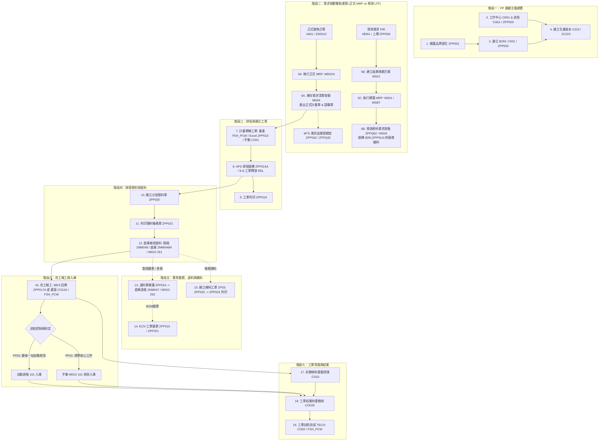
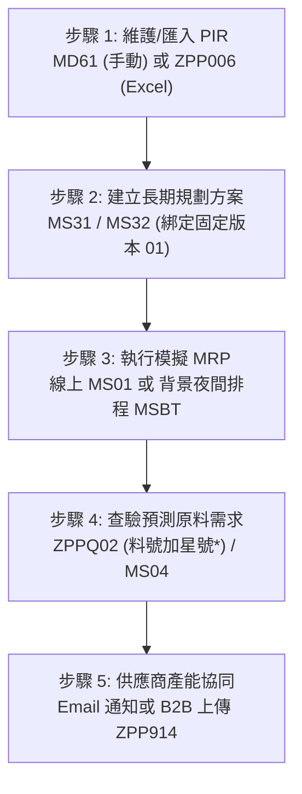
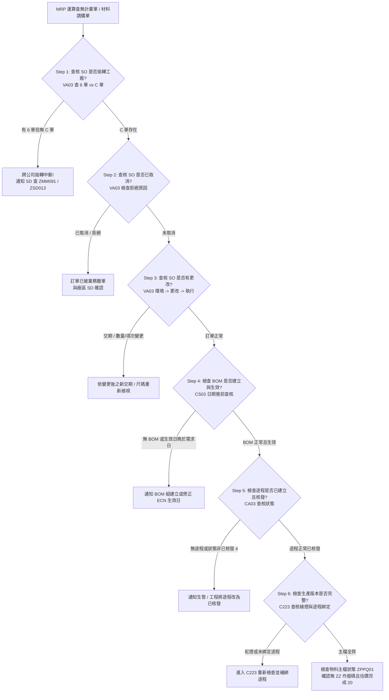
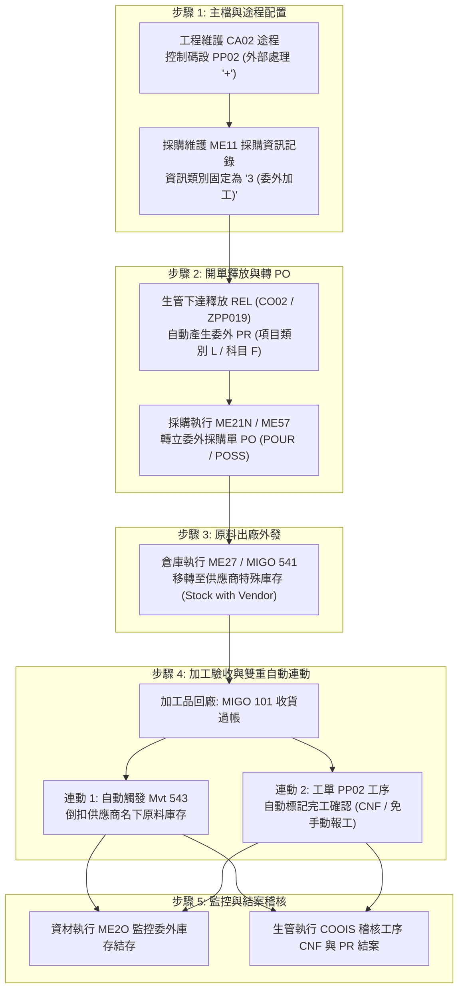
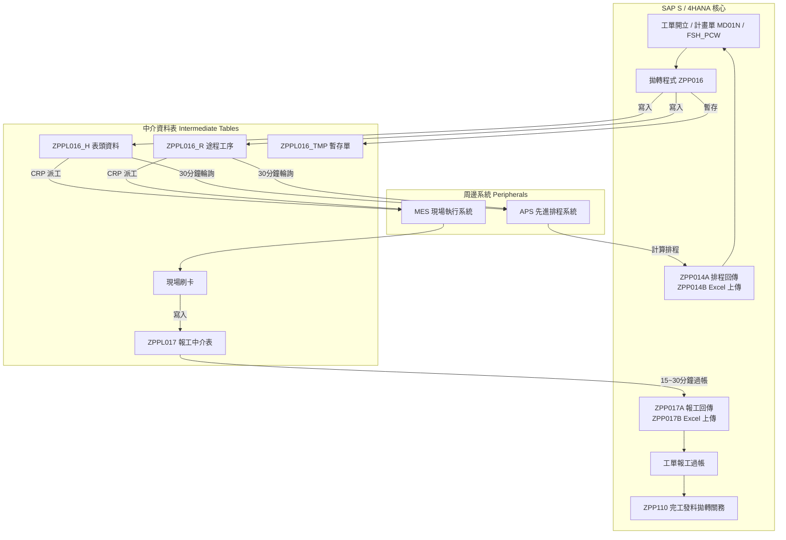
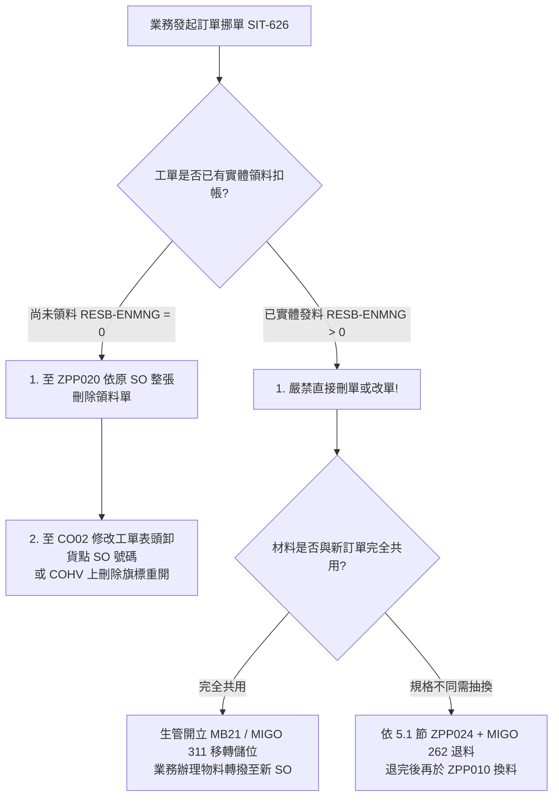
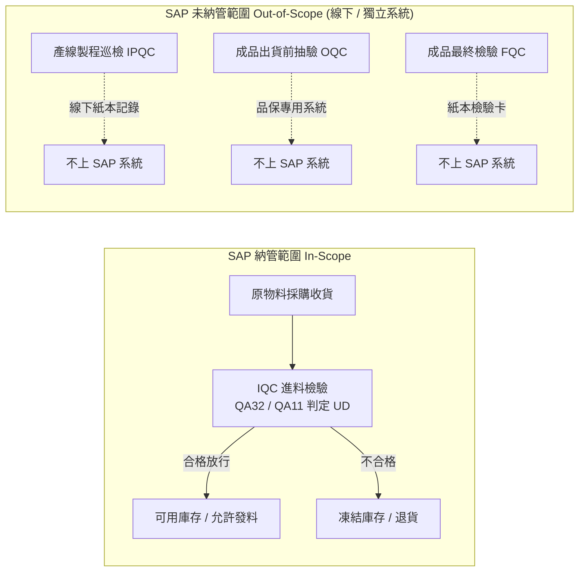

# [PP] 集團 SAP PP 模組日常業務實戰與異常處置全手冊 (KU & 一線排查指南)

> **適用對象**：PP Key User (KU)、生管人員、第一線現場排查人員 (@Triager)、跨模組顧問  
> **系統環境**：集團 SAP S / 4HANA (Fashion / 鞋業矩陣架構)

---

## 📑 手冊目錄全景導覽
- [第 0 章：集團 PP 核心工單體系 (ZP01~ZP07) 與跨部門 RACI 權責矩陣](#第-0-章集團-pp-核心工單體系-zp01zp07-與跨部門-raci-權責矩陣)
  - [0.1 集團 10 大生產業務場景與系統介接總覽矩陣 (Slide 17 全場景)](#01-集團-10-大生產業務場景與系統介接總覽矩陣-slide-17-全場景)
  - [0.2 ZP01~ZP07 核心工單屬性與執行參數對照表](#02-zp01zp07-核心工單屬性與執行參數對照表)
  - [0.3 跨部門角色職責與交接邊界矩陣 (RACI Matrix)](#03-跨部門角色職責與交接邊界矩陣-raci-matrix)
- [第 1 章：PP 基礎主檔建置深度實戰（部位 ➔ BOM ➔ 途程 ➔ 生產版本）](#第-1-章pp-基礎主檔建置深度實戰部位--bom--途程--生產版本)
  - [1.1 品牌部位代碼維護 (ZPP001)](#11-品牌部位代碼維護-zpp001)
  - [1.2 BOM 主檔與 Fashion 九宮格維護 (CS01 / CS02 / ZPP002)](#12-bom-主檔與-fashion-九宮格維護-cs01--cs02--zpp002)
  - [1.3 工作中心與標準途程建置 (CR01 / CA01 / ZPP003)](#13-工作中心與標準途程建置-cr01--ca01--zpp003)
  - [1.4 建立生產版本 (C223 / ZC223)](#14-建立生產版本-c223--zc223)
  - [1.5 虛擬階與非虛擬階的 BOM-途程-生產版本-資訊記錄關係對照表 (Slide 15)](#15-虛擬階與非虛擬階的-bom-途程-生產版本-資訊記錄關係對照表-slide-15)
- [第 2 章：需求規劃雙軌運算（正式 SO 跑 MD01N vs 預測 PIR 跑 MS01 / MSBT）](#第-2-章需求規劃雙軌運算正式-so-跑-md01n-vs-預測-pir-跑-ms01--msbt)
  - [2.1 需求來源查核（正式銷售訂單 MTO vs 預告訂單 Forecast SO vs 預測需求 PIR）](#21-需求來源查核正式銷售訂單-mto-vs-預告訂單-forecast-so-vs-預測需求-pir)
  - [2.2 正式訂單 MRP / MPS 運算 (MD01N / MD02)](#22-正式訂單-mrp--mps-運算-md01n--md02)
  - [2.3 庫存需求清單動態查核 (MD04 / MD04P)](#23-庫存需求清單動態查核-md04--md04p)
  - [2.4 預測計畫 PIR 與長期規劃模擬 MRP 專題 (ZPP006 / MS31 / MS01 / MSBT / ZPPQ02)](#24-預測計畫-pir-與長期規劃模擬-mrp-專題-zpp006--ms31--ms01--msbt--zppq02)
  - [2.5 客製需求追蹤號程式專題：ZPP042 與 ZPPQ42（深度實戰解析）](#25-客製需求追蹤號程式專題zpp042-與-zppq42深度實戰解析)
  - [2.6 MRP 實戰地雷排查](#26-mrp-實戰地雷排查)
  - [2.7 MRP 沒有跑出資料或與預期不符之六步標準排查樹 (Slide 5~14)](#27-mrp-沒有跑出資料或與預期不符之六步標準排查樹-slide-514)
- [第 3 章：排程與開立工單（FSH_PCW 轉工單 ➔ 下發釋放 ➔ 製程委外 ➔ 包裝單）](#第-3-章排程與開立工單計畫單轉工單--下發釋放)
  - [3.1 主檔計畫單轉量產工單 (FSH_PCW)](#31-主檔計畫單轉量產工單-fsh_pcw)
  - [3.2 批次 Excel 上傳開工單 (ZPP015)](#32-批次-excel-上傳開工單-zpp015)
  - [3.3 APS 排程拋轉與回傳 (ZPP014A / ZPP014B)](#33-aps-排程拋轉與回傳-zpp014a--zpp014b)
  - [3.4 工單釋放與列印 (ZPP019)](#34-工單釋放release與列印-zpp019)
  - [3.5 製程委外（工序外發 Subcontracting）標準閉環 SOP (途程 PP02)](#35-製程委外工序外發-subcontracting標準閉環-sop-途程-pp02)
  - [3.6 包裝工單 (ZP04) 與 VAS 客製加值服務獨立作業 (CO07)](#36-包裝工單-zp04-與-vas-客製加值服務獨立作業-co07)
  - [3.7 SAP 與周邊系統 (APS / MES) 介接流程與中介資料表架構 (Slide 18 & 19, Slide 3)](#37-sap-與周邊系統-aps--mes-介接流程與中介資料表架構-slide-18--19-slide-3)
- [第 4 章：現場領料與發料作業（分批領料 ZPP020 ➔ 倉庫檢貨發料 ZMM046/ZMM046M ➔ 貼合專題）](#第-4-章現場領料與發料作業)
  - [4.1 分批領料單開立與維護 (ZPP020)](#41-分批領料單開立與維護-zpp020)
  - [4.2 列印領料條碼單 (ZPP021)](#42-列印領料條碼單-zpp021)
  - [4.3 倉庫檢貨備料與工單發料過帳客製專題 (ZMM046 / ZMM046M / MIGO 261)](#43-倉庫檢貨備料與工單發料過帳客製專題-zmm046--zmm046m--migo-261)
  - [4.4 廠內貼合專題（合貼實體階 vs 虛擬階）](#44-廠內貼合專題合貼實體階-vs-虛擬階)
- [第 5 章：現場退料、元件變更與補料（退料過帳 ZMM047 ➔ ECN 改單 ➔ 補料單 ➔ 訂單挪單處置）](#第-5-章現場退料元件變更與補料重點-sop)
  - [5.1 現場退料三大情境與防呆 SOP (ZPP024 / ZMM047 / MIGO 262)](#51-現場退料三大情境與防呆-sop-zpp024--zmm047--migo-262)
  - [5.2 工單元件變更與三大禁忌 (ZPP010 / ZPP201/ ZPP032)](#52-工單元件變更與三大禁忌-zpp010--zpp201-zpp032)
  - [5.3 超耗與報廢補料工單 SOP (ZPP022 / ZPP023)](#53-超耗與報廢補料工單-sop-zpp022--zpp023)
  - [5.4 業務訂單挪單（Order Transfer，SIT-626）對生管工單之處置 SOP](#54-業務訂單挪單order-transfer-sit-626對生管工單之處置-sop)
  - [5.5 ECN 工程變更號碼前置建立與發起 (CC01 / CC02/ CC03)](#55-ecn-工程變更號碼前置建立與發起-cc01--cc02-cc03)
- [第 6 章：完工報工與產成品入庫（MES 拋轉 ➔ 自動入庫 ➔ 取消報工 CO13）](#第-6-章完工報工與產成品入庫)
  - [6.1 報工途徑與操作](#61-報工途徑與操作)
  - [6.2 MES 重複報工查核 SOP](#62-mes-重複報工查核-sop)
  - [6.3 產成品收貨入庫](#63-產成品收貨入庫)
  - [6.4 現場取消報工 / 報工反沖銷標準 SOP (CO13)](#64-現場取消報工--報工反沖銷標準-sop-co13)
  - [6.5 各廠區入庫作業模式與 QM 檢驗系統邊界 (Slide 3)](#65-各廠區入庫作業模式與-qm-檢驗系統邊界-slide-3)
- [第 7 章：工單結案前清理與技術完成 TECO（月結必備）](#第-7-章工單結案前清理與技術完成-teco月結必備)
- [第 8 章：第一線秒級故障排查急救表 (Cheat Sheet)](#第-8-章第一線秒級故障排查急救表-cheat-sheet)

---

## 🏭 端到端日常作業全景流程圖

---

## 第 0 章：集團 PP 核心工單體系 (ZP01~ZP07) 與跨部門 RACI 權責矩陣

### 0.1 集團 10 大生產業務場景與系統介接總覽矩陣 (Slide 17 全場景)

在集團鞋業運作中，各廠區與生管現場必須根據生產前置成熟度、客戶訂單來源與工廠型態，正確對應工單類型及周邊系統介接行為。以下矩陣完整收錄集團內部教學標準規範（*表頭與各欄皆已進行寬度保護，保證閱讀無不自然折行*）：

| <nobr>生產業務場景說明</nobr> | <nobr>工單類型</nobr> | <nobr>主檔需求</nobr> | <nobr>結算規則</nobr> | <nobr>MES輪次派工</nobr> | <nobr>SAP報工</nobr> | <nobr>產量上傳MES</nobr> | <nobr>工單入庫</nobr> |
| :--- | :---: | :---: | :---: | :---: | :---: | :---: | :---: |
| **開發樣試做**，由開發部備料，不一定有料號 | <nobr><b>NA</b></nobr> | <nobr>NA</nobr> | <nobr>NA</nobr> | <nobr>NA</nobr> | <nobr>NA</nobr> | <nobr>NA</nobr> | <nobr>NA</nobr> |
| **開發階段銷樣**（有料號，但 BOM 不完整、途程不完整、生產版本不完整），要出貨 &gt;&gt; 借項訂單 (ZD01) | <nobr><b>NA</b></nobr> | <nobr>NA</nobr> | <nobr>NA</nobr> | <nobr>NA</nobr> | <nobr>NA</nobr> | <nobr>NA</nobr> | <nobr>NA</nobr> |
| **量產主檔已維護，沒有客戶訂單**，產成品由現場技轉保留或研發部保留 | <nobr><b>ZP01 試量</b></nobr> | <nobr>BOM、途程、生產版本</nobr> | <nobr>自動帶</nobr> | <nobr>🔴 X</nobr> | <nobr>🟢 V</nobr> | <nobr>🔴 X</nobr> | <nobr>🟢 V</nobr> |
| **首單小批量試做**，有客戶訂單，依訂單出貨 | <nobr><b>ZP02 量產</b></nobr> | <nobr>BOM、途程、生產版本</nobr> | <nobr>自動帶</nobr> | <nobr>🟢 V</nobr> | <nobr>🟢 V</nobr> | <nobr>🟢 V</nobr> | <nobr>🟢 V</nobr> |
| **一般量產**，有客戶訂單，依訂單出貨 | <nobr><b>ZP02 量產</b></nobr> | <nobr>BOM、途程、生產版本</nobr> | <nobr>自動帶</nobr> | <nobr>🟢 V</nobr> | <nobr>🟢 V</nobr> | <nobr>🟢 V</nobr> | <nobr>🟢 V</nobr> |
| **依訂單國別出貨地決定的 VAS 物料外包材** | <nobr><b>ZP04 包裝</b></nobr> | <nobr>不展 BOM</nobr> | <nobr>銷售成本-重工 G / L 51110099</nobr> | <nobr>🔴 X</nobr> | <nobr>🔴 X</nobr> | <nobr>🔴 X</nobr> | <nobr>🔴 X</nobr> |
| **個別補料**，正單未完成（未入庫）補料 | <nobr><b>ZP03 單補料</b></nobr> | <nobr>BOM、途程、生產版本</nobr> | <nobr>自動帶</nobr> | <nobr>🔴 X</nobr> | <nobr>🔴 X</nobr> | <nobr>🔴 X</nobr> | <nobr>🔴 X</nobr> |
| **正單已完成**（入庫後 B / C 品），成套補料 | <nobr><b>ZP05 成套補料</b></nobr> | <nobr>BOM、途程、生產版本</nobr> | <nobr>自動帶</nobr> | <nobr>🟢 V</nobr> | <nobr>🟢 V</nobr> | <nobr>🟢 V</nobr> | <nobr>🟢 V</nobr> |
| **全製程代工** | <nobr><b>ZP06 全代工</b></nobr> | <nobr>BOM、途程、生產版本</nobr> | <nobr>自動帶</nobr> | <nobr>(同品牌受託廠)</nobr> | <nobr>🔴 X</nobr> | <nobr>(同品牌受託廠)(不對接SAP)</nobr> | <nobr>🟢 V</nobr> |
| **製程代工** | <nobr><b>ZP07 製程代工</b></nobr> | <nobr>受託廠不需要</nobr> | <nobr>銷貨成本-加工 51110002</nobr> | <nobr>🔴 X</nobr> | <nobr>(SAP報工)</nobr> | <nobr>🔴 X</nobr> | <nobr>🔴 X</nobr> |

> 📌 **欄位防呆解析**：
> 1. **`ZP01 試量`**：由於無正式客戶 SO 派工需求，MES 輪次不派工（MES 🔴 X），直接由生管在 SAP 手動報工（SAP 🟢 V），完工後 101 入庫作為技轉樣品。
> 2. **`ZP04 包裝`**：外包材不展階、不進 MES、不入庫（皆為 🔴 X），領料發料直接結轉銷貨重工成本科目 `51110099`。
> 3. **`ZP03` vs `ZP05`（關鍵差異）**：正單**未入庫前**的個別缺料用 **`ZP03`**（不走 MES 報工與入庫，直接領料補回線邊）；正單**已入庫結案後**產生的 B / C 品成套補做，必須開立 **`ZP05`**（完整走 MES 派工、SAP 報工與產量上傳、工單入庫流程）！

---

### 0.2 ZP01~ZP07 核心工單屬性與執行參數對照表

本表針對各工單類型的開單交易碼、領料單類別及成本歸集特性進行深度定義（*關鍵代碼與欄位均已加註防止折行保護*）：

| <nobr>工單類型</nobr> | <nobr>中文名稱</nobr> | 核心業務場景 | <nobr>觸發開單 T-Code</nobr> | <nobr>領料單類別 (ZPP020)</nobr> | 成本歸集與結算特點 |
| :---: | :---: | :--- | :---: | :---: | :--- |
| <nobr><b><code>ZP01</code></b></nobr> | <nobr><b>試量生產工單</b></nobr> | 開發 / 試產/試做鞋型小批量試量投產。 | <nobr><code>CO01</code> / <code>FSH_PCW</code></nobr> | <nobr>正單 (ZP01 / ZP02)</nobr> | 歸集至開發 / 試產專案成本，SIT-609 <!-- 來源: scenario_pp_mm_fi_sit-609_試量生產.md -->。 |
| <nobr><b><code>ZP02</code></b></nobr> | <nobr><b>量產工單</b></nobr> | 業務正式接單（MTO / MTS）之大貨量產，主檔計畫單轉工單。 | <nobr><code>FSH_PCW</code> / <code>ZPP015</code></nobr> | <nobr>正單 (ZP01 / ZP02)</nobr> | 必填利潤中心，成本結轉至庫存產成品與銷貨成本。 |
| <nobr><b><code>ZP03</code></b></nobr> | <nobr><b>超耗單補料工單</b></nobr> | 現場加工不良、人為報廢或材料瑕疵需超額個別補料（正單未入庫）。 | <nobr><code>ZPP022</code></nobr> | <nobr>補料工單 (ZP03 / ZP05)</nobr> | 成本獨立歸集至該補料工單，利於月結進行超耗異常分析。 |
| <nobr><b><code>ZP04</code></b></nobr> | <nobr><b>包裝工單</b></nobr> | 成品鞋裝箱、加附吊牌、貼標或 VAS 客製化加值包裝（不展BOM）。 | <nobr><code>CO07</code></nobr> | <nobr>包裝工單 (ZP04)</nobr> | 領用包裝材（紙箱、乾燥劑、鞋撐、條碼標籤），結算至銷貨成本-重工。 |
| <nobr><b><code>ZP05</code></b></nobr> | <nobr><b>成套補料工單</b></nobr> | 正單已入庫後之 B / C 品，成套補料重新投產（走 MES 輪次派工）。 | <nobr><code>ZPP022</code></nobr> | <nobr>補料工單 (ZP03 / ZP05)</nobr> | 結算規則自動帶，完整走 MES 派工與報工入庫。 |
| <nobr><b><code>ZP06</code></b></nobr> | <nobr><b>全代工工單 (委託廠)</b></nobr> | 全製程委外代工時，委託方於系統中開立之追蹤工單。 | <nobr><code>ZPP015</code> / <code>CO08</code></nobr> | <nobr>委託廠代工領料單</nobr> | 追蹤外發原物料耗用與代工成品驗收入庫；受託廠端不對接本廠 SAP 報工。 |
| <nobr><b><code>ZP07</code></b></nobr> | <nobr><b>製程代工工單 (受託廠)</b></nobr> | 承接集團內其他廠區委託代工生產時開立之製程工單（受託廠不需要完整成品 BOM / 途程）。 | <nobr><code>CO07</code></nobr> | <nobr>受託廠領料單</nobr> | 結算至銷貨成本-加工 51110002，由受託廠在 SAP 報工，不對接 MES 產量。 |

---

### 0.3 跨部門角色職責與交接邊界矩陣 (RACI Matrix)
現場卡關或單據阻擋時，依照下表責任歸屬迅速派工，杜絕跨部門踢皮球：

> **說明**：**R** (Responsible, 執行負責) / **A** (Accountable, 最終核准) / **C** (Consulted, 協同審核) / **I** (Informed, 接收通知)

| 業務流程環節 | 生管 (PP) | 開發 / BOM組 | 業務 (SD) | 資材 / 倉庫 (MM) | 品管 (QM) | 成本會計 (CO) | 關鍵交付成果與前置要求 |
| :--- | :---: | :---: | :---: | :---: | :---: | :---: | :--- |
| **1. 品牌部位與 BOM 建立** | **C** | **R / A** | **I** | **C** | **I** | **C** | 部位 `ZPP001`、BOM `CS01`、九宮格分配檔維護。 |
| **2. 途程與工作中心維護** | **C** | **R / A** | **I** | **I** | **C** | **A** | 工作中心 `CR01` 指派成本中心、途程 `CA01` 設定控制碼。 |
| **3. 生產版本綁定 (C223)** | **R** | **C** | **I** | **I** | **I** | **I** | 狀態必須亮綠燈，生效日期必須大於等於途程日期。 |
| **4. 需求建立 (SO / PIR)** | **C** | **I** | **R (SO)** | **I** | **I** | **I** | 業務於 `VA01` 開 SO，生管於 `MD61` / `ZPP006` 上傳 PIR。 |
| **5. 執行 MRP / MPS** | **R / A** | **I** | **I** | **I** | **I** | **I** | 正式 SO 跑 `MD01N` 產出正式計畫單與 PR；預測 PIR 跑 `MS01 / MSBT` (LTP 模擬 MRP)。 |
| **6. 計畫單轉量產工單** | **R / A** | **I** | **I** | **I** | **I** | **I** | `FSH_PCW` 轉 `ZP02`，確認利潤中心與卸貨點 SO 必填。 |
| **7. 需求追蹤號綁定 (ZPP042)** | **R** | **I** | **I** | **C** | **I** | **I** | 請購轉採購後執行 `ZPP042`，為 MTS 材料回填 PO 追蹤號。 |
| **8. 開立分批領料單 (ZPP020)** | **R / A** | **I** | **I** | **I** | **I** | **I** | 依現場成型日與首投製程拆單，避免殘留。 |
| **9. 倉庫發料過帳 (MIGO 261)** | **I** | **I** | **I** | **R / A** | **C (UD)** | **I** | 倉儲憑單過帳扣帳，檢驗品需 QM 放行方可發料。 |
| **10. 現場退料與元件變更** | **R (退單 / ECN)** | **C** | **I** | **R (262過帳)** | **I** | **I** | 生管 `ZPP024` 申請 ➔ 倉儲 `262` 過帳 ➔ 生管 `ZPP010` 改單。 |
| **11. 完工報工與成品入庫** | **R (報工)** | **I** | **I** | **R (入庫)** | **C (QA32)** | **I** | 現場報工，`PP03` 自動 101 入庫或倉儲手動 101 收貨。 |
| **12. COGI 異常清理** | **R** | **I** | **I** | **C (補足庫存)** | **I** | **I** | 生管查核倒扣失敗料件，資材補足儲位後重新過帳。 |
| **13. 工單技術完成 (TECO)** | **R** | **I** | **I** | **C** | **I** | **A** | `COOIS` 結案前四重稽核通過後，生管下達 `TECO`。 |
| **14. 成本月結計算與結算** | **I** | **I** | **I** | **I** | **I** | **R / A** | 財務執行 `KKS2` 計算差異並於 `CO88` 結算工單損益。 |

---

## 第 1 章：PP 基礎主檔建置深度實戰（部位 ➔ BOM ➔ 途程 ➔ 生產版本）

### 1.1 品牌部位代碼維護 (ZPP001) <!-- 來源: ku_pp_zpp001_品牌部位代號及名稱維護.md -->
* **用途**：定義鞋型之裁斷部位代號（如鞋面 Upper、鞋舌 Tongue、鞋帶 Lace、內裡 Lining）。
* **操作方式**：
  1. 輸入 `ZPP001`，選擇「維護資料」，輸入品牌代號執行。
  2. 點擊「新增部位代號」或「上傳檔案」（支援 Excel 批次導入）。
  3. ⚠️ **關鍵關聯（部位 vs 首投製程 vs 領料單拆單之精準分工）**：
     * **拆單的直接依據 100% 是【首投製程】**：在 `ZPP020` 中，鞋廠產生領料單號的核心拆單規則是 `銷售訂單 + 合併主檔工單 + 【首投製程】 + 元件儲存地點`。系統是依照工段（如 `01 裁斷`、`03 針車`、`05 成型`、`09 貼合`）將一張訂單的材料拆分成不同工段的實體領料單，並非按「部位」拆單（一雙鞋有數十個部位，若按部位拆單倉庫將被單據淹沒）。
     * **「部位代號」在系統中的樞紐角色**：
       1. **帶出首投製程的觸發源**：生管在 BOM 維護（`CS01`）輸入排序字串（部位代號）時，客製程式才能**自動帶出部位說明並自動匹配寫入該材料的「首投製程代碼 (STPO-ZZFIRST)」**！
       2. **單據明細標示**：在 `ZPP021` 打印領料單時，部位代號會轉換為部位中文 / 英文說明（如鞋舌、鞋面、鞋墊），讓倉管與產線一眼看清這批料用於鞋身哪一部位。
     * 💡 **結論**：**「首投製程」是領料單拆單的直接判定欄位；而「部位代號」是帶出首投製程與單據說明的前置根基！** 若 BOM 未維護部位導致 `STPO-ZZFIRST` 為空，`ZPP020` 將無法正確拆單歸類！

---

### 1.2 BOM 主檔與 Fashion 九宮格維護 (CS01 / CS02/ ZPP002) <!-- 來源: ku_pp_cs01_cs02_bom建立維護作業.md --> <!-- 來源: ku_pp_cs01_cs02_bom建立維護作業.md --> <!-- 來源: ku_pp_zpp002_bom上傳_更改與下載.md -->
在鞋業 Fashion 系統中，BOM 採用 **GA（通用母階料號）** 與 **VA（尺碼變體子階料號）** 架構：

1. **基本建立欄位**：
   * **BOM 使用**：固定填 `1`（生產）。
   * **排序字串**：填入部位代號（自動帶出首投製程）。
   * **虛擬階設定**：特殊採購填 `50`（虛擬階）；若針對特定鞋型需管庫存，展開類型放 `Z1`（退出虛擬裝配）。
   * **替代料群組**：替代項目群組由 `A1` 起編，策略固定選 `2`，使用機率設 `100` 或 `0`。
2. **數量分配設定檔（九宮格 Size Run）與升降碼**：
   * 點選「數量分配設定檔」，展開各尺碼用量矩陣。
   * **升降碼機制**：當女鞋 W'S 5 碼需採購 3.5 碼底台時，第一個組態類別放母階料號 300 變式，第二個組態類別放子階 300 變式，系統展 BOM 與跑 MRP 即會自動轉算跨碼材料。
3. **💥 必知大雷：GA BOM 與 VA BOM 不一致排查與修復**：
   * **現象**：ECN 變更後，母階（GA）有新料，但子階（VA）漏料，導致材料漏買或 COOIS 異常。
   * **底層機制**：Fashion 底層透過 `FSH_BOM_VD` 資料表串聯，若 `FSH_BOM_VD.V_STLNR = ''`（為空），代表 VA BOM 脫鉤。
   * **標準修復 SOP**：
     * **方式 A**：執行專案修復程式 **`ZPPBOMFIX`**（批次背景修復，可在 `SLG1` 物件 `FSH_BOM` 查核修復 Log）。
     * **方式 B（手工修復）**：進 `CS02` 帶入 ECN 號碼 ➔ 點選異常項次元件 ➔ 開啟**九宮格** ➔ **清除 VA 對應用量後存檔 ➔ 再次進入九宮格重新填回用量存檔**，強迫系統重刷寫入 `FSH_BOM_VD`。

---

### 1.3 工作中心與標準途程建置 (CR01 / CA01/ ZPP003) <!-- 來源: ku_pp_cr01_cr02_工作中心維護.md --> <!-- 來源: ku_pp_ca01_建立標準途程.md --> <!-- 來源: ku_pp_zpp003_routing上傳.md -->

#### A. 8 大途程控制碼（Control Key）全解析矩陣（一線必查）
途程中的控制碼決定了單據開立、排程、委外、報工及入庫的自動化行為：

| 控制碼 | 處理方式 | 強制報工 (Cnf) | 外部處理 | 自動收貨入庫 | 排程 / 成本 | 核心應用場景與系統行為 |
| :---: | :---: | :---: | :---: | :---: | :---: | :--- |
| **`PP01`** | 廠內自製 | **2 (需要確認)** | 空格 | ❌ 否 | ✔ 算排程 / 成本 | **標準核心工序**。裁斷、針車、成型等核心站，現場完工必須手動進系統報工。 |
| **`PP02`** | 委外代工 | 空格 (不可報) | **`+` (委外)** | ❌ 否 | ✔ 算委外交期 | **工序委外加工**。工單釋放時**自動開立採購申請 (PR)**，廠內不報工，廠商交貨時透過 `MIGO 101` 採購收貨即視為完工。 |
| **`PP03`** | 廠內自製 | **2 (需要確認)** | 空格 | **✔ 自動入庫** | ✔ 算排程 / 成本 | **最後一站自動入庫**。手動報工完工瞬間，**背景自動過帳 101 成品收貨**！ ⚠️ **鐵律**：整張工單**只能放一次且必須在最後一站**，若放 2 筆 PP03 自動入庫將完全失效！ |
| **`PP04`** | 廠內自製 | **2 (需要確認)** | 空格 | ❌ 否 | ✔ 算排程 / 成本 | **含品管檢驗**。釋放時自動觸發 QM 03 檢驗批，品管必須於 `QA32` 錄入檢驗特性數據並做 UD 放行。 |
| **`PP05`** | 廠內自製 | **1 (里程碑確認)** | 空格 | ❌ 否 | ✔ 算排程 / 成本 | **里程碑報工（買一送多）**。當報工本站時，系統**自動把前面所有尚未報工的自製工序一併完成報工**，適合多道連續站之關鍵彙總站。 |
| **`PP06`** | 委外代工 | **1 (里程碑確認)** | **`+` (委外)** | ❌ 否 | ❌ 不算廠內排程 | **委外 + 里程碑**。外協廠商做完送回，倉庫執行委外收貨（`MIGO 101`）時，自動將該站及前面所有廠內漏報工序一併補齊！ |
| **`PP07`** | 委外代工 | 空格 (不可報) | **`+` (委外)** | **✔ 自動入庫** | ✔ 算委外交期 | **委外即為最後一站**。外包加工為最後一道工序，廠商送回倉庫刷委外收貨時，連同整張生產工單成品入庫一次自動辦完。 |
| **`PP08`** | 廠內自製 | **1 (里程碑確認)** | 空格 | **✔ 自動入庫** | ✔ 算排程 / 成本 | **自製終極大招（PP05 + PP03）**。放在最後一站，現場只需刷此站報工，自動完成：『前面所有站補報工』+『成品 101 入庫』！ |
| **`PP99`** | 純文字 | **3 (不可能確認)** | 空格 | ❌ 否 | ❌ 不算排程 / 成本 | **備註便簽工序**。不計產能、不計成本、無法報工。純用於現場看備註（如靜置冷卻）或接 MES 虛擬節點。 |

#### B. 途程工時與產能計算公式
* **$AF$（基礎數量）** = 工作中心每日產量（依型體設定，雙）
* **$AK$（直接人工）** = 工作中心每日總工時（分鐘）
* **最大分割數** = 工序配置的機台數或作業人數（縮短排程天數，不影響總人工工時）
* **報工工時計算公式**：
  $$\text{系統報工工時} = \left(\frac{AK \text{ (直接人工)}}{AF \text{ (基礎數量)}}\right) \times \text{工單報工完成量}$$
  $$\text{產線實際排程耗時} = \frac{\text{總作業工時}}{\text{最大分割數}}$$

---

### 1.4 建立生產版本 (C223 / ZC223) <!-- 來源: ku_pp_c223_建立生產版本.md --> <!-- 來源: ku_pp_zc223_大量建立生產版本.md -->
* **用途**：將 BOM 替代、途程群組、批量範圍與有效期間進行四合一綁定。
* **防呆要點**：
  * 點擊「檢查」圖示，狀態必須亮 **🟢 綠燈**（BOM 與途程皆有效）。
  * ⚠️ **常見地雷**：生產版本的有效開始日期，**必須大於或等於途程的生效日期**！若途程 6 / 12 生效但版本設 6 / 5，後續轉工單時會噴錯：`未維護訂單類型ZP02作業產生的預設值`。

---

### 1.5 虛擬階與非虛擬階的 BOM-途程-生產版本-資訊記錄關係對照表 (Slide 15)

在集團鞋業 BOM 表結構中，料件分為「非虛擬階（自製 vs 外購）」與「虛擬階（Phantom Assembly）」，不同層級在 SAP 各模組主檔中的必備維護維度截然不同：

| <nobr>物料階層與特性</nobr> | <nobr>SOBSL</nobr> | <nobr>BOM</nobr> | <nobr>途程</nobr> | <nobr>版本</nobr> | <nobr>資訊記錄</nobr> | 業務實戰說明與鞋業產線行為（核心重點） |
| :--- | :---: | :---: | :---: | :---: | :---: | :--- |
| **非虛擬階 - 廠內自製** | <nobr>—</nobr> | <nobr>🟢 V</nobr> | <nobr>🟢 V</nobr> | <nobr>🟢 V</nobr> | <nobr>🔴 X</nobr> | **成品鞋、廠內自製底半品、自製貼合布**。在廠內實體投產，必須維護工序工時以利 APS 排程、CRP 派工與月結人工成本分攤。 |
| **非虛擬階 - 外購品** | <nobr>—</nobr> | <nobr>🟢 V</nobr> | <nobr>🔴 X</nobr> | <nobr>🔴 X</nobr> | <nobr>🟢 V</nobr> | **外購原料、五金飾扣、外購鞋底、化學品**。不在廠內生產故**無須途程與版本**；MRP 運算直接產生採購請購單（PR），採購必備 ME11 核價記錄。 |
| **虛擬階 (Phantom)** | <nobr><b>50</b></nobr> | <nobr>🟢 V</nobr> | <nobr>🔴 X</nobr> | <nobr>🔴 X</nobr> | <nobr>🔴 X</nobr> | **鞋面虛擬總成、裁斷部件虛擬包、虛擬貼合**。用於 BOM 結構化管理，MRP 運算直接穿透展開至最底層材料，**不獨立開工單，亦無實體庫存帳**（現場若對其發料會跳防呆代碼 `E008`）。 |
| **特殊退出虛擬裝配** | <nobr><b>50+Z1</b></nobr> | <nobr>🟢 V</nobr> | <nobr>🟢 V</nobr> | <nobr>🟢 V</nobr> | <nobr>依來源</nobr> | **特殊專案或特定廠區需獨立管控半品庫存時**，於 BOM 項目維護展開類型 `Z1`（退出虛擬裝配），系統將其跳出虛擬模式，視為實體半品開立獨立工單！ |

> 📌 **欄位簡寫對照說明**：  
> * **`SOBSL`**：特殊採購碼（Special Procurement Type，如 `50: 虛擬階`）  
> * **`BOM`**：物料清單維護（T-Code: `CS01`）  
> * **`途程`**：標準途程工時與工作中心維護（T-Code: `CA01`）  
> * **`版本`**：生產版本四合一綁定（T-Code: `C223`）  
> * **`資訊記錄`**：採購資訊記錄（T-Code: `ME11`）  
>
> 💡 **一線速查訣竅**：
> 1. 外購的項次因為不在廠內生產，**絕對不需要維護途程**；若誤建途程，轉工單時會因無對應成本中心而拋錯。
> 2. 虛擬階材料（`SOBSL=50`）在系統中純粹是「打包架構」，**不需要途程與生產版本**；若現場試圖對虛擬階直接開領料單，系統會直接跳出防呆代碼 **`E008` (虛擬階不可直接發料)**！

---

## 第 2 章：需求規劃雙軌運算（正式 SO 跑 MD01N vs 預測 PIR 跑 MS01 / MSBT）

在集團鞋業的整體供應鏈架構中，需求規劃分為兩條**截然不同、嚴格隔離的雙軌作業體系**：
1. **正式訂單軌（MTO 大貨量產）**：依據業務正式客戶訂單（`ZSD012 / VA01`），透過 **`MD01N`** 執行正式 MRP，直接產出**正式計畫單與採購請購單（PR）**，進入後續開工單與實體採購流程。
2. **預測計畫軌（PIR 長期規劃 LTP）**：依據品牌預估量（`MD61 / ZPP006`），**絕對不跑 `MD01N`**，而是建立方案（`MS31`）後透過 **`MS01 / MSBT`** 執行模擬 MRP，產出**模擬計畫單**與預測用料需求（`ZPPQ02`），專供供應商產能預估與長交期原料備料，絕不干擾正式庫存與工單！

---

### 2.1 需求來源查核（正式銷售訂單 MTO vs 預告訂單 vs 預測需求 PIR）

| <nobr>需求類型</nobr> | <nobr>單據載體與 T-Code</nobr> | <nobr>適用場景與品牌模式</nobr> | <nobr>MRP 運算 T-Code</nobr> | <nobr>產出單據特性</nobr> | 後續業務閉環重點 |
| :--- | :--- | :--- | :---: | :--- | :--- |
| **1. 正式銷售訂單** *(MTO 接單生產)* | <nobr><code>VA01</code> / <code>ZSD012</code></nobr> (訂單類型 ZOR1 / ZCT4) | 客戶正式確認下單之大貨量產，指定款式、配色、Size Run 與交期。 | <nobr><b><code>MD01N</code></b> (MRP Live)</nobr> | <nobr><b>正式主檔計畫單</b></nobr> + 採購請購單 (PR) | 轉量產工單 (`FSH_PCW` / `ZPP015`)，採購轉 PO，排產入庫出貨。 |
| **2. 預告訂單** *(Forecast SO)* | <nobr><code>VA01</code> / <code>ZSD012</code></nobr> (訂單類型 ZA01 / ZCT4) | 客戶尚未給正式單，但需提前採購長交期原料（如特定皮料、特殊五金）。*(依品牌，與 PIR 二擇一)* | <nobr><b><code>MD01N</code></b> (MRP Live)</nobr> | <nobr><b>正式請購單 (PR)</b></nobr> 供提前採購下單 | 採購成立後，業務必須立即至 `ZSD019` 將預告訂單上**拒絕原因 `Z3 預告訂單關閉`**，避免後續正式單疊加重複採購！ |
| **3. 計劃獨立需求** *(PIR 滾動預測)* | <nobr><code>MD61</code> (手動)</nobr> <nobr><code>ZPP006</code> (Excel上傳)</nobr> | 客戶提供未來 3~6 個月滾動 Forecast，僅供產能評估與供應商備料參考。*(不直接投產)* | <nobr><b><code>MS01</code> (線上)</b></nobr> <nobr><b><code>MSBT</code> (背景Job)</b></nobr> | <nobr><b>模擬計畫訂單</b></nobr> (Simulative Planned Order) | 透過 `ZPPQ02` 查詢原料用量，刪除敏感欄位後 Email 廠商或上傳 B2B 平台（`ZPP914`）。 |

---

### 2.2 正式訂單 MRP / MPS 運算 (MD01N / MD02) <!-- 來源: ku_pp_md01n_執行mps_mrp.md --> <!-- 來源: scenario_pp_mm_sit-601_成品鞋接單到出貨_有_forecast.md -->
* **適用對象**：業務開立之正式銷售訂單（`ZOR1`）或預告訂單（`ZA01`）。
* **操作參數**：
  * 輸入工廠代碼（如鞋廠、底廠），範圍設定為全部或特定物料。
  * **處理模式 (Processing Key)**：設定為 `NETCH`（淨更改規劃）或 `NEUPL`（重新規劃）。
  * **建立 MRP 清單**：設 `1`（適應規劃資料）。
  * **排程 (Scheduling)**：設 `2`（前置作業時間排程，計算精確開完工日）。
* **執行成果**：系統即時比對庫存、在途、安全庫存與需求，產出正式**主檔計畫單（Planned Order）**與下階外購料之**採購請購單（PR）**。

---

### 2.3 庫存需求清單動態查核 (MD04 / MD04P) <!-- 來源: ku_pp_md04_md07_庫存需求清單.md --> <!-- 來源: ku_pp_md04p_庫存_需求溯源.md -->
* **`MD04` (庫存/需求清單)**：動態展現個別物料之現存量、在途 PR/PO、已開工單需求量與缺料日；雙擊單據可查看 BOM 展開與缺料情況。
* **`MD04P` (庫存/需求溯源)**：點擊「訂單路線（Pegged Requirements）」，可逆向追蹤此筆請購需求或計畫單到底是在支撐哪一張客戶銷售訂單（SO）。

---

### 2.4 預測計畫 PIR 與長期規劃模擬 MRP 專題 (ZPP006 / MS31 / MS01 / MSBT / ZPPQ02) <!-- 來源: ku_pp_md61_md62_預測及長期規劃維護作業.md --> <!-- 來源: ku_pp_ms31_ms32_建立長期規劃方案.md --> <!-- 來源: ku_pp_ms01_msbt_執行模擬mrp(ms01).md --> <!-- 來源: scenario_pp_mm_sit-601_成品鞋接單到出貨_有_forecast.md#L60-L68 --> <!-- 來源: issue_pp_all_sap_issue_logs_常見異常與處置彙整.md#L390-L403 -->

在集團鞋業管理中，**預測需求（PIR）絕對不能直接執行 `MD01N`**！因為若對尚未確立之預測量跑正式 MRP，系統會直接產生成千上萬張正式 PR 與計畫單，污染現場正常排程並引發錯誤採購。集團標準採用 **SAP 長期規劃（Long-Term Planning, LTP）模擬機制**：

#### 1. LTP 模擬規劃五步驟全景流程

#### 2. 詳細操作說明與關鍵眉角
* **步驟一：維護 / 上傳 PIR (`MD61` / `ZPP006`)**：
  * 手動維護：至 `MD61` 輸入料號、工廠與規劃期間；**版本固定填 `'01'` (Dean 預測版本)**，期間指示填 `M`（月）或 `W`（週）。
  * 批次匯入：業務或生管使用客製程式 **`ZPP006`** 上傳 PIR Excel 檔，由系統批次寫入。查閱使用 `MD63` 或 `MD79`。
* **步驟二：建立長期規劃方案 (`MS31` / `MS32`)**：
  * 至 `MS31` 建立專屬 Planning Scenario 代碼與說明。
  * 設定規劃起訖日期，在「版本」指定關聯的 PIR 版本為 `'01'`，並指派生效工廠，儲存後設定為立即或背景排程生效。
* **步驟三：執行模擬 MRP (`MS01` / `MSBT`)**：
  * **線上即時運算：`MS01`**。輸入規劃方案代碼、工廠代碼，處理代碼選 `NETCH`，計劃模式選 `3`（刪除並重建計劃資料），排程選 `1`，執行後產出模擬結果。
  * **系統夜間排程：`MSBT`**。正式環境每日夜間由系統背景固定執行 `MSBT` 批次運算，因此日間匯入 PIR 後，翌日清晨即可查得最新運算數據。
  * 💡 **資料隔離核心**：`MS01 / MSBT` 產出的是**「模擬計畫訂單 (Simulative Planned Orders)」**，僅存於長期規劃模擬區，**完全不產生正式採購 PR，不佔用正式庫存，亦不轉工單**！
* **步驟四：預測原料需求查詢與廠商協同 (`ZPPQ02` / `ZPP914`)**：
  * 生管進入 **`ZPPQ02`**（預測數量查詢報表），輸入規劃料號與工廠。
  * ⚠️ **關鍵排查技巧**：**料號後方必須加星號 `*`（例如 `FGU1-6024946-713*`）**！因為工廠端鋪貨建置只鋪 VA（尺碼變式）料號，若未加星號僅輸 GA 料號，系統將無法展開各尺碼之材料需求用量！
  * 匯出 Excel 清單後，生管依照資安規範**刪除客戶訂單雙數與敏感商業欄位**，透過郵件寄發供應商，或透過客製檔案上傳介面 **`ZPP914`** 上傳至 B2B 供應商協同平台，供原物料廠商預留產能與提前備料。

---

### 2.5 客製需求追蹤號程式專題：ZPP042 與 ZPPQ42（深度實戰解析）

在鞋業生產規劃中，**`ZPP042`** 與 **`ZPPQ42`** 是極為關鍵的**「採購單需求追蹤號碼綁定與查詢機制」**：

#### A. 業務背景與核心痛點（為什麼必須執行 ZPP042？）
* **MTO（按單生產）物料**：客製材料在請購轉採購時，SAP 原生標準會在採購單項目帶入客戶銷售訂單號（SO）與項次，天然具備溯源性。
* **MTS（備庫生產）物料**：鞋廠大量共用的**底半品 EVA、共用鞋墊、射出大底、通用五金飾扣或批次統購原料**，採購單（PO）在 SAP 標準邏輯中**不會直接綁定銷售訂單號**。
* **現場痛點**：生管與資材在查看 `COOIS` 資材分析表時，會看到一堆 MTS 採購單，卻**無法得知這批採購到底在支撐哪張銷售訂單**，容易造成備料混亂或重複買料。
* 💡 **`ZPP042` 的核心價值**：在採購單開立後，自動比對前端計畫單與 SO 需求，將「需求追蹤號碼」回填至採購單，實現 MTS 材料與銷售訂單的精確綁定！

#### B. 程式功能、底層架構與關鍵資料表
* **`ZPP042`**：**採購單需求追蹤號碼寫入程式**（手動執行或背景 Job 排程）。
* **`ZPPQ42`**：**需求追蹤號碼查詢報表**（前台即時查驗單據對應關係）。
* **底層核心資料表與欄位**：
  * `EKPO-BEDNR`：採購單項目之「需求追蹤號碼（Requirement Tracking Number）」，`ZPP042` 寫入的目標欄位。
  * `EBAN-BEDNR`：請購單項目之需求追蹤號碼。
  * `ZPP042_2`：**採購單追蹤號碼工廠設定參數表**（定義各工廠代碼之編碼規則、啟用旗標與追蹤邏輯）。
  * `ZMMT059_3` / `ZMMT059_4`：工廠與物料群組參數預設檔（定義 MTO / MTS 策略與採購類型）。
* ⚠️ **核心原則**：**「只有 MTS 行為的材料有需要使用 ZPP042」**！若為純 PIR 預測（尚未有正式接單）或物料原本即為 MTO，則跳過此步驟。

#### C. ZPP042 / ZPPQ42 標準執行 SOP
| 步驟 | 負責模組 | 交易代碼 (T-Code) | 操作步驟說明 | 輸入資料 / 建議設定 | 產出成果 / 驗證方式 |
| :---: | :---: | :---: | :--- | :--- | :--- |
| **1** | MM | `ME57` / `ME21N` | 原料 / 底半品請購轉採購單 | 請購單號、供應商代碼、採購單類型（如 `POUR`/`POSS`） | 產生採購單號 (PO) |
| **2** | PP | `ZPP042` | **執行需求追蹤號碼綁定** | 輸入工廠、採購單號或日期區間（亦可由系統夜間背景 Job 自動執行） | 系統批次將需求追蹤號寫入 `EKPO-BEDNR` |
| **3** | PP | `ZPPQ42` | **查詢與查驗追蹤號碼** | 輸入工廠代碼、物料號碼或採購單號 | 清單顯示採購單項目、物料清單及對應之需求追蹤號碼 |
| **4** | PP / 資材 | `COOIS` | **資材分析表關聯查驗** | 選擇清單「/PP-003 資材分析表」，輸入銷售訂單號查詢 | 檢核「採購文件」欄位是否成功帶出 MTS 採購單 |

#### D. 與 `COOIS`（/PP-003 資材分析表）的連動判定規則
在 `COOIS` 資材分析表的「採購文件」欄位中：
* **顯示 `MTO 採購單號`**：物料為 MTO 性質，SAP 原生自動綁定。
* **顯示 `MTS 採購單號`**：物料為 MTS 性質，且**已成功透過 `ZPP042` 完成需求溯源**，成功對應到該銷售訂單。
* **顯示 `空白`**：表示尚未開立採購單，或該 MTS 採購單**尚未執行 `ZPP042`**，導致系統無法匹配銷售訂單。

#### E. 第一線常見異常排查指引
1. **問題：執行 `ZPP042` 後，`ZPPQ42` 查詢追蹤號碼仍為空白？**
   * **排查 1**：確認物料主檔與參數表 `ZMMT059_3` 是否設定為 MTS（集體需求）；若為 MTO，程式會略過。
   * **排查 2**：檢查參數表 `ZPP042_2`，確認該生產工廠是否已維護並啟用設定檔。
   * **排查 3**：檢查前置的 MRP 主檔計畫單是否已被手動刪除，或該銷售訂單是否已被設定拒絕原因（如 Z3）。
2. **問題：預告訂單（Forecast SO）轉正式訂單時的重複需求？**
   * 在 `SIT-601`（步驟 10~14）預告訂單模式下，執行 `ZPP042` 確認採購成立後，業務單位必須立即至 `ZSD019` 將預告訂單設定拒絕原因（`Z3 預告訂單關閉`），避免後續正式接單時需求重複疊加導致多買原料！

---

### 2.6 MRP 實戰地雷排查
* **0.001 的微小差異原因**：
  * **MRP 計畫單展開**：標準功能採**四捨五入法**算至小數第 3 位。
  * **開立工單展開**：標準工單元件採**無條件進位法**算至小數第 3 位。兩者可能產生 0.001 碼 / 公斤之尾差，此為系統底層標準邏輯，屬正常現象。
* **物料有變更卻未跑出請購單**：
  * 進入 `SE16N` 查閱 Table `PPH_DBVM`，若「淨更改規劃」標記為 `'X'` 且 MRP 時間印記早於更新時間，代表該料待跑 MRP，手動以 `MD02` 重跑即可。

---

### 2.7 MRP 沒有跑出資料或與預期不符之六步標準排查樹 (Slide 5~14)

當業務抱怨「訂單已經給了，為什麼生管 MRP 跑不出計畫單或材料請購單？」時，生管第一線人員與 KU 應循以下內部教學標準六步排查樹進行診斷：

#### 步驟 1：確認銷售訂單是否有拋到廠區（`VA03`：先查 6 開頭訂單，再查 C 開頭訂單）
* **跨公司接單拋轉邏輯**：
  1. 品牌客戶下單 ➔ 透過 `Degen` / `ZSD012` 手動或自動產生 **`6` 開頭銷售訂單**（集團貿易公司接單 SO）。
  2. 系統後台自動排程（每 2 小時或立即觸發）：由 `ZMM091` 產生貿易公司內部採購單 ➔ `ME59N` 自動轉 PO ➔ 自動拋轉產生 **`C` 開頭銷售訂單**（生產廠區工廠 SO）。
  3. 跨公司單據變更則由 `ZSD013` 自動更新或 `ZSD019` 批量上傳更新。
* ⚡️ **生管秒級排查規則**：
  * 生管日常排產與開工單**原則上只要確認 `C` 單**。
  * 若業務宣稱下單，但生管查無 `C` 單：請至 `VA03` 先查 `6` 單。**若「有 6 開頭訂單、卻無 C 開頭訂單」，代表 6 單拋轉至 C 單失敗！此為 SD 模組程式中斷，生管切勿自行開單，應立即聯繫 SD 負責人處理（排查 `ZMM091` / `ZSD013`）**。

#### 步驟 2：確認銷售訂單是否已被取消（`VA03`）
* 進入 `VA03` 查看該 `C` 開頭銷售訂單表頭與各項次之狀態。
* 若訂單整張或特定尺碼已被維護「拒絕原因（Reason for Rejection）」，MRP 運算時將自動將其剔除，不再產生任何生產計畫與材料請購需求。若單據已取消，生管無須排產，請 USER 自行與廠區 SD 確認是否撤單。

#### 步驟 3：確認銷售訂單是否有歷程更改（`VA03`）
* 若訂單未取消，但現場發現計畫單數量或交期與記憶中不符：
* **操作途徑**：在 `VA03` 訂單畫面中，點選頂部功能表 **「環境 (Environment)」➔「更改 (Changes)」➔「執行」**。
* **效果**：系統進入「顯示文件更改」歷史清單，完整揭露哪位使用者於何時將數量由 1,000 雙改為 500 雙、更動了工廠代碼或調整了預計出貨日。

#### 步驟 4：檢查 BOM 是否建立及 ECN 更改歷史（`CS03`）
* 1. **確認 BOM 是否存在**：先確認該成品是否有有效 BOM；若為半成品（如底半品、貼合料），確認中階 BOM 是否完整建立。
* 2. ⚠️ **關鍵技巧：查詢生效日期最好放前面一點的日期**！若 MRP 需求日為 2026 / 05/01，但 BOM 生效日維護為 2026 / 06/01，MRP 運算將完全抓不到任何下階物料！
* 3. **檢查 ECN 變更歷程**：確認是否有工程變更生效日晚於訂單需求日。
  * *實例*：項次 0120 材料由 `RPO1-00431-00002` 變更為 `RPO1-00431-00003`，ECN 變更號碼為 `500000000008`，生效日為 `2025 / 03/11`。若訂單需求日在生效日前，系統仍只會抓舊料！

#### 步驟 5：檢查標準途程是否建立且「已核發」（`CA03`）
* 1. 確定該產成品料號於該工廠已建立途程群組。
* 2. ⚠️ **鐵律防呆**：**確定途程狀態為「4 (已核發 / Released)」**！若工程建立途程後忘記核發，狀態仍為「1 (建立中 / 草稿)」，MRP 引擎在前置時間排程時將認定無有效途程而拒絕排產！

#### 步驟 6：檢查生產版本是否完整並正確綁定途程（`C223`）
* 1. 進入 `C223`，核對生產版本檢查狀態是否亮 **🟢 綠燈**。
* 2. 確定生產版本的「途程（Routing）」欄位後面已正確掛上途程群組與群組計數器。若版本僅掛了 BOM 但途程為空，MRP 只能算靜態用量，無法展開排程產能需求！

---

#### 🛠️ 物料主檔綜合狀態快速體檢工具：`ZPPQ01` 與狀態碼意義
第一線生管無須逐筆切換 `CS03`/`CA03`/`C223`，可直接執行集團客製報表 **`ZPPQ01` (物料主檔查詢與維護)**：
* **BOM存在 / 途程存在 / 生產版本存在** 欄位：
  * 若顯示 **`Y`**，代表主檔記錄存在。
  * ⚠️ **血淚提醒**：**「是 Y 僅代表資料存在，但不保證資料內容與生效日正確！」** 仍需按步驟 4~6 進行明細確認。
* **查核物料狀態代碼（關鍵防呆）**：
  * **跨廠物料狀態若是 `ZZ`**：代表該物料已在集團層級**「作廢」**，不可用於任何生產與採購！
  * **工廠特定物料狀態 (MARC-MMSTA)**：
    * **`ZZ`**：工廠端作廢。
    * **`00`**：Initial status（初始建置，未放行）。
    * **`20`**：**已完成成本估算 (Costing Completed)**！只有狀態為 `20` 的物料才能順利進行工單開立、發料過帳與財務月結成本計算。

---

## 第 3 章：排程與開立工單（計畫單轉工單 ➔ 下發釋放）

### 3.1 主檔計畫單轉量產工單 (FSH_PCW) <!-- 來源: ku_pp_fsh_pcw_建立量產工單-主檔計畫單轉主檔工單.md -->
鞋業量產一律使用時尚工作台 `FSH_PCW`：
1. 輸入工廠與銷售訂單號，進入工作台。
2. 左側選取主檔計畫單，點擊「轉換為生產訂單」，訂單類型選擇 **`ZP02` (量產工單)**。
3. 系統產生「主檔訂單號」及「各尺碼分單」。
4. ⚠️ **關鍵防呆欄位**：
   * **利潤中心 (Profit Center)**：**必填**！若為空值或填錯，後續將導致報工阻擋、無法入庫且工單月結會計拋帳失敗！
   * **卸貨點 (Unloading Point)**：維護貿易廠接單 SO（指令單號）。
   * **儲存地點**：維護產成品預設入庫倉碼。

### 3.2 批次 Excel 上傳開工單 (ZPP015) <!-- 來源: ku_pp_zpp015a_sap上傳excel建立工單.md -->
* 依標準模板填寫後導入，若報錯對照：
  * `E002`：Excel 尺碼與銷售訂單主檔不符。
  * `E003`：累計開單數量超過銷售訂單數量。

### 3.3 APS 排程拋轉與回傳 (ZPP014A / ZPP014B) <!-- 來源: ku_pp_zpp014a_sap接收aps生產排程回傳.md --> <!-- 來源: ku_pp_zpp014b_下載上傳生產排程.md -->
* 透過 `ZPP016` 將工單同步至周邊 APS 系統排產；排程完成後透過 `ZPP014A` 自動回傳排程開完工日，或以 `ZPP014B` 上傳更新。

### 3.4 工單釋放（Release）與列印 (ZPP019) <!-- 來源: ku_pp_zpp019_生產訂單列印.md -->
* 工單建立後狀態為 `CRTD`（已建立），需於 `CO02` 或批次 `COHV` 執行釋放，狀態轉為 **`REL` (已釋放)**。
* ⚠️ **只有在 `REL` 狀態下，工單的物料預留單（Reservation）才真正生效，現場才能開領料單！**
* 透過 `ZPP019` 列印工單流轉卡與條碼。

### 3.5 製程委外（工序外發 Subcontracting）標準閉環 SOP (途程 PP02 / 541 / 543)
當裁斷或針車後之半成品需送往外協廠商進行加工（如鞋面電繡、高週波、特殊印花、特殊轉印）時，系統採標準委外閉環作業（參照 SIT-612 <!-- 來源: scenario_mm_pp_fi_sit-612_集團外委外採購.md -->）：

#### A. 端到端五步標準作業步驟詳解
| 步驟 | 交易代碼 (T-Code) | 作業名稱 | 權責角色 | 輸入資料 / 核心設定 | 產出成果與防呆機制 |
| :---: | :---: | :--- | :---: | :--- | :--- |
| **1** | `CA02` / `ME11` | 途程工序 PP02 與委外資訊記錄維護 | 工程部 (IE) / 採購 (MM) | 1. 途程控制碼設 **`PP02`** (外部處理填 `+`) 2. `ME11` 建立資訊記錄，資訊類別選 **`3 (委外加工)`**，填入加工淨價與計畫交貨天數 | 途程具備外發委外屬性，廠內該站不排產能。 ⚠️ **若未維護 ME11 類別 3 記錄，工單釋放將報錯阻擋 (`E_SUB_NO_ME11`)**！ |
| **2** | `CO02` / `ZPP019` / `ME21N` | 工單釋放 (REL) 自動產出 PR 並轉 PO | 生管 (PP) / 採購 (MM) | 1. 生管執行工單釋放 (`REL`) 2. 採購於 `ME21N` / `ME57` 選取 PR 轉委外 PO (單據類型 `POUR`/`POSS`) | 釋放瞬間系統自動產生委外 PR (項目類別 `L` 委外加工，科目分配 `F` 訂單)。 💡 **工單在 `CRTD` 狀態下絕不會產生 PR**。 |
| **3** | `ME27` / `MIGO` (541) | 倉庫外發料件移轉至供應商庫存 | 倉管 (MM) | 進入 `ME27` 或 `MIGO` 選擇「A08 移轉過帳」➔「R08 生產訂單 / 採購單」，執行異動碼 **`541`** | 原材料由廠內可用庫存移轉至「供應商特殊庫存 (Stock with Subcontractor)」。 ⚠️ **物料產權仍屬廠內，不產生會計憑證。若未過帳 541，後續收貨將爆發 `E_SUB_541_LACK`**！ |
| **4** | `MIGO` (101) | 加工品送回驗收入庫 (雙重自動連動) | 倉管 (MM) / 品管 (QM) | 廠商加工完成送回廠內，倉庫至 `MIGO` 選擇「A01 收貨」➔「R01 採購單」過帳 **`101`** | **【雙重自動連動機制】**： 1. 系統自動在背景產生 **`543`** 異動，倒扣該委外供應商庫存的原物料耗用。 2. **該生產工單 PP02 工序自動標記完工確認 (`CNF`)，現場完全免手動報工**！ |
| **5** | `ME2O` / `COOIS` | 委外庫存監控與工單工序稽核 | 資材 / 生管 (PP) | 1. 執行 `ME2O` (委外庫存監控報表) 2. 執行 `COOIS` 查核工序與採購申請清單 | 查核供應商名下原料結存是否完全歸零；確認工單 PP02 工序已達 CNF 且無多餘掛帳。 |

#### B. 製程委外工序兩大高頻核心地雷與秒級排查指引
1. **`E_SUB_NO_ME11` 委外工序缺乏採購資訊記錄 (ME11 遺失)**：
   * **現象**：途程工序設為 PP02，工單釋放時跳出「採購資訊記錄不存在」或採購開立 PO 阻擋。
   * **根本原因**：工程部建立了 PP02 途程，但採購端未在 `ME11` 建立對應料號與供應商之「委外加工類別 3」資訊記錄。
   * **秒級處置**：通知採購至 `ME11` 維護採購資訊記錄，資訊類別固定選取 **`3 (委外加工)`**，填入加工費淨價、稅碼與計畫交貨天數；生管至 `CO02` 重新讀取途程外部處理資料後重新釋放 (`REL`)。
2. **`E_SUB_541_LACK` 製程委外供應商在庫不足 (541 未轉撥導致 101/543 失敗)**：
   * **現象**：委外廠商送回加工品，倉庫於 `MIGO` 做 101 採購收貨時，系統報錯「Deficit of SC Stock (委外庫存不足)」。
   * **根本原因**：101 收貨在背景必須連帶觸發 `543` 異動扣減該供應商名下之原材料。但倉庫先前出廠時**未執行 `Mvt 541` 移轉，或發出數量少於標準耗用**，導致供應商處無帳面庫存可扣！
   * **秒級處置**：生管/資材至 `ME2O` 查核該委外廠商之原材料結存；倉管使用 `ME27` 或 `MIGO 541` 將廠內原料補足移轉至供應商庫存；補足後重新至 `MIGO 101` 收貨，系統即可順利自動帶出 543 扣帳並將工序標記完工！

> 💡 **互動實驗室沙盤指引**：本手冊配套系統已於【Tab 2: 互動排查決策樹與實驗室】提供 **「🧪 5. 製程委外 (PP02 / 541 / 543) 防呆模擬沙盒」**，現場人員可動態撥動「ME11 存在狀態」、「541 移轉數量」與「101 收貨動作」，即時觀看系統終端報錯代碼與雙重自動連動解鎖！

---

### 3.6 包裝工單 (`ZP04`) 與 VAS 客製加值服務獨立作業 (CO07) <!-- 來源: ku_pp_co07_建立包裝工單.md -->
* **業務時機**：成型後之成品鞋需進行特殊外箱組裝、裝入鞋撐 / 乾燥劑、加掛品牌特定 RFID 吊牌、貼外箱條碼或 VAS（Value-Added Services）加值作業。
* **開單流程**：
  1. 生管進入 `CO07`（無物料生產訂單建立），選擇訂單類型 **`ZP04` (包裝工單)**。
  2. 參考銷售訂單展開包裝材料明細（紙箱、吊牌、包裝袋、條碼貼紙）。
  3. 進入 `ZPP020` 建立領料單時，**工單種類選取「包裝工單 (ZP04)」**，獨立開立包裝領料單交由外包裝倉或成品倉發料。
  4. 包裝完成後進行報工與完工入庫，包裝工單之成本獨立核算，與主鞋體製造成本脫鉤。

---

### 3.7 SAP 與周邊系統 (APS / MES) 介接流程與中介資料表架構 (Slide 18 & 19, Slide 3)

集團生產高度仰賴周邊系統協同運作：SAP 掌管核心主檔與財務物料帳，**APS (先進規劃排程系統)** 負責有限產能排程，**MES (製造執行系統)** 負責產線刷卡派工與報工收集。以下剖析介接架構、中介資料表與維運排查工具：

#### A. SAP ➔ APS 介接流程與中介 Table (`ZPPL016_H` / `ZPPL016_R`)
1. **資料拋轉 (`ZPP016`)**：
   * 生管下達或背景 Job 每 15~30 分鐘執行 `ZPP016`，將計畫單或工單資料寫入中介資料表：
     * **`ZPPL016_H`**：儲存工單表頭、料號、雙數、開完工日。
     * **`ZPPL016_R`**：儲存途程工序、工作中心、工時與機台需求。
     * **`ZPPL016_TMP`**：拋轉暫存單。
2. **APS 排程回傳 SAP (`ZPP014A` / `ZPP014B`)**：
   * APS 完成產能排產後，透過 **`ZPP014A`** 自動將最新排程開完工日期寫回 SAP 工單。
   * 💡 **應急方案**：若介面連線中斷或排程大量調單，生管可使用 **`ZPP014B`** 下載排程 Excel，線下調整後重新上傳覆寫 SAP 工單排程。

#### B. SAP ➔ MES 介接流程（現場 CRP 派工）
* 透過 `ZPP016` 將工單途程資訊拋至 CRP 系統，進而派工至各車間現場 MES 終端機，產線組長即可在平板電腦看到當日各線輪次派工清單。

#### C. MES ➔ SAP 報工回傳與中介 Table (`ZPPL017`)
1. **現場刷卡報工 (`ZPP017A`)**：
   * 現場員工刷作業條碼，MES 收集產出良品、報廢雙數與工時，寫入中介資料表 **`ZPPL017`**。
   * 背景 Job 定時（每 15~30 分鐘；特定廠區如 NB 廠 T012 每晚 20:00 一次）執行 `ZPP017A` 批次呼叫 BAPI 過帳 SAP 報工憑證。
2. **手工 / 應急報工 (`ZPP017B`)**：
   * 無 MES 之衛星廠或 MES 系統當機時，生管可使用 **`ZPP017B`** 透過標準 Excel 範本批量上傳報工數據至 SAP。
3. **保稅關務拋轉 (`ZPP110`)**：
   * 工單完工報工發料後，系統透過 **`ZPP110`** 將發料與完工記錄自動同步至保稅關務系統，確保海關帳與 SAP 財務帳一致。

---

#### D. 中介資料表處理狀態碼 (`ZZIFSTATUS`) 的核心意義與排查對策
生管或第一線 IT 在 `SE16N` 查閱 `ZPPL016_H`、`ZPPL016_R` 或 `ZPPL017` 時，關鍵鎖定欄位 **`ZZIFSTATUS`**：
* **`I` (Initial，預設值)**：資料已寫入中介表，**尚未被背景 Job 處理**。若單據長期停留在 `I`，請至 `SM37` 檢查對應之 Background Job 是否中斷或被取消。
* **`F` (Finished / Success)**：**處理成功**！資料已順利過帳至 SAP 或周邊系統。
* **`E` (Error，錯誤阻擋)**：**處理發生錯誤**！此為第一線排查熱點，必須點開錯誤日誌欄位檢視報錯原因：
  * *常見原因 1*：工單未維護利潤中心（Profit Center），導致過帳失敗。
  * *常見原因 2*：工作中心未綁定成本中心，或報工日期處於財務關帳月份。
  * *常見原因 3*：庫存儲位被盤點鎖定（Lock），倒扣料失敗。

---

#### E. 工單動態批量調整工具箱（現場實戰必備，Slide 3）
在開立工單後，面對突發狀況，生管可利用以下專用客製程式進行批次微調，免去逐張改單的繁瑣人工：
1. **批量調整工單作業站點自製與委外 (`ZPP031`)**：
   * **業務場景**：當廠內裁斷或針車產能滿載，需將原本自製的站點（PP01）臨時整批外發加工（PP02）；或外協廠商罷工需臨時收回廠內自製。
   * **功能**：輸入工單範圍與目標工序，批次變更途程控制碼，系統自動觸發或撤銷委外 PR。
2. **工單決定替代料 (`ZPP032`)**：
   * **業務場景**：**僅化工 / 膠水/特殊配方使用**！
   * **功能**：輸入工單號碼與確定的替代料料號，程式自動將該替代料之使用比率調整為 **`100%`**，並同步將群組內其他替代料的比率重置為 **`0%`**，確保現場與 MRP 精準領用特定化學配方。

---

## 第 4 章：現場領料與發料作業

### 4.1 分批領料單開立與維護 (ZPP020) <!-- 來源: ku_pp_zpp020_分批領料單維護.md --> <!-- 來源: spec_pp_zpp020_分批領料單維護.md -->
* 生管依生產線別、成型日、首投製程建立領料單。
* **操作眉角**：
  1. 先勾選「**僅預覽**」並執行，確認材料用量無誤後，取消打勾再次執行儲存，正式產生領料單號。
  2. ⚠️ **刪除領料單注意事項**：若需作廢領料單，**必須依「銷售訂單號」整張查詢並刪除**！若僅依工單或單一製程查詢勾選刪除，會造成後台項次殘留，導致後續無法重新建立領料單。
  3. ⚠️ **備料單狀態防呆鎖定 (`ZMMT046`)**：若倉庫已在 `ZMM046 / ZMM046M` 產生備料單，且狀態為 `I`（待處理：已調撥至待發料倉但尚未執行 261 過帳）或 `M`（處理中：倉庫人員揀貨中），系統嚴格禁止生管刪除領料單！此時必須先通知倉庫人員取消備料單並復原狀態，方可執行刪單。

### 4.2 列印領料條碼單 (ZPP021) <!-- 來源: spec_index.md -->
* 產出包含料號、批次、儲位條碼之實體單據交由倉庫揀料。現場領料單號編碼規則：鞋廠為「銷售訂單 + 合併主檔工單 + 首投製程 + 儲存地點」；底廠則依工單生產料號之物料群組拆單。

### 4.3 倉庫檢貨備料與工單發料過帳客製專題 (ZMM046 / ZMM046M / MIGO 261) <!-- 來源: cross_module_rules.md --> <!-- 來源: spec_index.md --> <!-- 來源: spec_pp_zpp020_分批領料單維護.md --> <!-- 來源: scenario_pp_mm_sit-601_成品鞋接單到出貨_有_forecast.md -->

在集團鞋業與底廠的標準發料體系中，倉庫發料作業並非僅依靠 SAP 標準 `MIGO`，而是全面導入針對鞋業製程與條碼客製開發的 **`ZMM046` 系列檢貨備料程式**，達成現場條碼防呆與工單即時扣帳之高度整合：

#### 1. 鞋廠 vs 底廠專用發料程式分工矩陣

| <nobr>作業廠區 / 適用工單</nobr> | <nobr>專用發料 T-Code</nobr> | <nobr>單據輸入來源</nobr> | <nobr>背景異動類型</nobr> | 業務場景與執行邏輯 |
| :--- | :---: | :---: | :---: | :--- |
| **鞋廠（成型 / 鞋面 / 底台）** *(ZP01 / ZP02 / ZP03 / ZP05)* | <nobr><b><code>ZMM046</code></b></nobr> 工單備料單檢貨備料 | <nobr>領料單號 (<code>ZPP020</code>)</nobr> | <nobr><b>Mvt. 261</b> (對工單發料)</nobr> | 倉管依 `ZPP021` 條碼掃描領料單，進行成型、針車等工單之檢貨備料與發料過帳。若為正單加補單，系統支援彙總檢貨過帳。 |
| **底廠 / 受託代工廠（底半品 / 粗胚）** *(底廠半成品工單)* | <nobr><b><code>ZMM046M</code></b></nobr> 底半品備料單領料 | <nobr>領料單號 (<code>ZPP020</code>)</nobr> | <nobr><b>Mvt. 261</b> (對工單發料)</nobr> | 專為底廠配方粗胚、射出、組底半成品工單設計之領料過帳程式，依底半品領料單進行檢貨發料。 |
| **標準例外 / 線下緊急手工發料** | <nobr><b><code>MIGO</code></b></nobr> 標準發貨作業 | <nobr>工單號 / 預留單號</nobr> | <nobr><b>Mvt. 261</b> (發貨 R08 工單)</nobr> | 僅於客製程式異常或特殊無領料單情境下，手動選擇 A07 發貨 ➔ R08 生產訂單輸入預留號過帳。 |

#### 2. PP ➔ MM 領料發料閉環鏈條與即時查核
1. **生管開單**：PP 執行 `ZPP020`，系統依「銷售訂單 + 合併主檔工單 + 首投製程 + 儲位」自動拆單產出領料單號。
2. **條碼列印**：執行 `ZPP021` 列印附帶條碼的實體領料單交由倉庫。
3. **檢貨過帳**：倉庫執行 `ZMM046`（鞋廠）或 `ZMM046M`（底廠），掃描領料單條碼進行實體揀料與確認過帳，系統背景呼叫 BAPI 執行異動類型 `261`，扣減儲位庫存並產生物料文件。
4. **生管即時查驗 (`COOIS`)**：
   * 過帳成功後，工單預留資料表（`RESB-ENMNG`）之已領用數量即刻累加。
   * 生管隨時進入 `COOIS`（清單選「元件」），核對「**領料數量 (Withdrawn Quantity)**」；當領料數量等於需求數量時，代表現場已全數領料到位！

#### 3. 備料單防呆鎖定機制 (`ZMMT046`)
* 備料單於底層記錄於 `ZMMT046` 資料表，具備生命週期狀態旗標：
  * **狀態 `I` (待處理)**：已產生備料單並調撥至待發料倉，但尚未執行 261 扣帳。
  * **狀態 `M` (處理中)**：倉庫人員正在檢貨作業中。
* ⚠️ **生管刪單嚴格防呆**：當 `ZMMT046-ZZSTATUS` 為 `'I'` 或 `'M'` 時，`ZPP020` 嚴格禁止刪除領料單！此時生管畫面會拋出阻擋訊息；生管若確認需作廢領料單，必須聯絡倉庫人員至 `ZMM046` 將備料單取消或復原狀態，方可執行刪單。

#### 4. WMS 現代化倉儲整合模式
* 在導入 WMS（自動化立體倉儲）的現代化廠區，系統具備以下自動化中介介面：
  * `ZMM046` 產生備料單 ➔ 透過 **`ZMM085`** 自動拋轉備料單至 WMS 系統。
  * 倉管於 WMS 完成自動化揀貨出庫後 ➔ 透過 **`ZMM086` / `MIGO`** 自動將實領資料回傳 SAP 執行 261 工單發料過帳。

#### 5. 品管檢驗防呆 (QM UD)
* 若原料為 QM 列管品，若尚未經由品管於 `QA32` / `QA11` 完成使用決策（Usage Decision, UD）放行，`ZMM046` 與 `MIGO` 過帳時將直接跳出 **`E023 (批次未達檢驗放行)`** 阻擋，嚴禁現場混入未檢合格料件！

### 4.4 廠內貼合專題（合貼實體階 vs 虛擬階）
* **合貼實體階**：
  * 廠內貼合不綁單，合併材料總量開立實體合貼工單。
  * 提前 1~2 週開 `ZPP020` 領原材料，合貼廠報工後，成品以 `MIGO`（A01+R08）入庫面倉（RD料），鞋面現場再憑領料單向面倉領用。
* **合貼虛擬階**：
  * 物料主檔設虛擬階（特殊採購 50），直接綁定銷售訂單，**RD 料號無獨立工單**！
  * 貼合廠依 `ZPP020` Excel 領料單篩選「首投製程 `09:貼合`」自行加總領料。
  * 貼合成品實物交面倉，**系統無庫存帳（走手工帳）**，後續由鞋面工單統一倒扣。

---

## 第 5 章：現場退料、元件變更與補料（重點 SOP）

### 5.1 現場退料三大情境與防呆 SOP (ZPP024 / ZMM047 / MIGO 262) <!-- 來源: ku_pp_zpp024_退料單維護.md --> <!-- 來源: issue_pp_all_sap_issue_logs_常見異常與處置彙整.md#L240-L265 --> <!-- 來源: scenario_pp_mm_sit-601_成品鞋接單到出貨_有_forecast.md --> <!-- 來源: scenario_pp_mm_sit-650_生產過程ecn.md -->

現場退料時，**嚴禁採用未指定工單的彙總退料**，否則因系統自動攤提會產生尾差殘留！退料作業由 **生管提出申請（`ZPP024`）** 與 **倉庫過帳點收（`ZMM047` / `MIGO 262`）** 雙方密切協同閉環：

#### 1. 退料三大情境與作業矩陣

| <nobr>退料情境</nobr> | 適用時機與業務情境 | <nobr>生管發起 T-Code</nobr> | <nobr>倉庫過帳 T-Code</nobr> | 標準操作流程與防呆重點 |
| :--- | :--- | :---: | :---: | :--- |
| **1. 工單退料** *(最常用核心)* | 因 ECN 改單、製程多領、更換配方需將材料退庫。 | <nobr><b><code>ZPP024</code></b> 退料單維護</nobr> | <nobr><b><code>ZMM047</code></b> MM 退料單過帳 *(或 MIGO 262)*</nobr> | 1. 生管於 `ZPP024` 選擇指定工單與「原首投製程」建立退料單。 2. 倉庫人員至 **`ZMM047`** 輸入退料單號點收實物並過帳（背景執行 **異動類型 `262` 工單發料沖銷**）。 3. 實領數（`RESB-ENMNG`）沖銷歸零後，生管方可在 `ZPP010` 抽換元件。 |
| **2. 銷售訂單退料** | 整批訂單完工後，現場剩餘之共用尾料退庫（不分 size）。 | <nobr><b><code>ZPP024</code></b></nobr> | <nobr><b><code>ZMM047</code> / <code>MIGO</code></b></nobr> | 透過銷售訂單對應之退料功能辦理退庫，退入共用原料儲位。 |
| **3. 成本中心退料** *(虛擬階/盤點)* | 現場餘料當月無工單可退、未來無訂單，或虛擬階貼合餘料、年度盤點餘料。 | <nobr><b><code>ZPP024</code></b> *(選成本中心模式)*</nobr> | <nobr><b><code>ZMM047</code> / <code>MIGO 202</code></b></nobr> | 異動至指定製造費用成本中心沖銷，不影響特定工單成本。 |

#### 2. MM 退料單過帳專用程式 (`ZMM047`) 運作細節
* **專用對接**：集團客製程式 **`ZMM047`** 為 MM 倉庫對應 PP `ZPP024` 退料單的唯一標準過帳窗口（SIT-601、SIT-605、SIT-633、SIT-650 共通標準）。
* **操作流程**：
  1. 倉管進入 `ZMM047`，輸入 `ZPP024` 列印之「退料單號」。
  2. 系統自動檢核該單之原發料工單號、料號、原發料儲位、批次及申請退料數量。
  3. 倉管點收實體材料確認無誤後，點擊過帳，系統背景呼叫 BAPI 執行 **Movement Type `262` (針對生產訂單沖銷發料)**。
  4. 系統產生 `262` 物料文件，庫存即時回沖至原料儲位，工單 `RESB-ENMNG` 即刻扣減。

#### 3. 退料對 PP 後續作業的兩大強制約束
1. **ECN 元件抽換之前提（解鎖 `E005`）**：
   * 若工單元件已有發料紀錄（`RESB-ENMNG > 0`），生管在 `ZPP010` / `CO02` 刪除或更換該元件時，系統會直接跳出 **`E005 (已領料不可刪除元件)`** 報錯！
   * **唯一解法**：必須先由生管開 `ZPP024`，經倉庫於 `ZMM047` 執行 262 退料，直到該元件之實領數扣至 `0` 之後，`ZPP010` 才會解除鎖定允許改單。
2. **防止月結成本尾差與重工差額**：
   * 領料退料必須嚴格依照「首投製程」與「原發料工單」對應退料，嚴禁跨工單或跨製程混退，以避免工單刪除或月結時因成本投入不均產生重工借貸尾差。

#### 4. 實戰專題：虛擬階 RD 貼合材料現場餘料退料 SOP (Task #62286 實例)
* **背景現象**：
  * 例如 RD 貼合料號 `RDO1-00272-00024`（特殊採購 `50` 虛擬階），BOM 規定用量 72.577 碼。
  * 倉庫在 `ZMM046` 檢貨發出下階原料給現場貼合，現場貼合完成後剩餘 3 碼多原料，欲退回倉庫。
* **專家處置指引**：
  1. **日常運作原則（現場手工帳，日常不退料）**：虛擬階 RD 材料在 SAP 系統中**不設定庫存帳**（走現場手工帳）。日常作業中，現場剩餘原料應自行保管留給後續損耗或後續訂單耗用，等同後續接單的預補單與補料工單可以少開，**日常作業不需要 by 指令退料**！
  2. **必須退料情境（取消訂單 / 年度盤點）**：若客人取消訂單、該鞋型確定停產無後續訂單耗用，或年度盤點結餘時，才需辦理實物退料。
  3. **退料路徑**：由於虛擬階工單不直接發料（無實體發料工單），**無法走標準工單 262 退料**！生管必須調整 `ZPP024` 上傳檔案格式，指定為 **「成本中心退料」**，退料單開立後由倉庫於 `ZMM047 / MIGO` 過帳退回原料倉。
  4. **後續訂單耗用**：退回倉庫之虛擬階料件若未來有新訂單，因虛擬階不跑 MRP 扣庫存，生管必須手動調整工單並產生 `ZPP020` 領料單，方能由倉庫再次發料。

### 5.2 工單元件變更與三大禁忌 (ZPP010 / ZPP201/ ZPP032) <!-- 來源: ku_pp_zpp010_ecn調整工單.md --> <!-- 來源: spec_index.md --> <!-- 來源: ku_pp_zpp032_批量調整工單替代料.md -->
* ⚠️ **第一大禁忌：切勿在 `CO02` 手動修改工單元件**！
  * **嚴重後果**：`CO02` 手動調整的料件**無法與 BOM 建立關聯**，導致後續 `ZPP020` 領料單**完全無法帶出首投製程**，現場無法依製程分批發料！
  * **正確做法**：必須使用 **`ZPP010` (ECN調整工單)** 進行變更，系統才會同步維護 BOM 關聯性。
* ⚠️ **第二大禁忌：已領料元件不可直接刪除**！
  * 若元件已有發料紀錄（`RESB-ENMNG > 0`），直接刪除會跳 **`E005` (已領料不可刪除元件)**。必須先循 5.1 節透過 `262` 退料至實領數為 0，才能於 `ZPP010` / `CO02` 刪除該元件。
* **替代料切換**：若特定材料斷料需啟用替代料，使用 `ZPP032` 依替代料群組批次切換工單用料。

### 5.3 超耗與報廢補料工單 SOP (ZPP022 / ZPP023) <!-- 來源: ku_pp_zpp022_補料工單建立.md --> <!-- 來源: spec_index.md -->
* 現場因人為不良或重大瑕疵超耗時：
  1. 進入 `ZPP022`，輸入原量產工單號與補料數量，系統自動開立 **`ZP03` (補料工單)**。
  2. 透過 `ZPP023` 列印補料單，經審批後開立 `ZPP020` 領料單發料。補料成本將獨立核算，不污染原正單成本。

---

### 5.4 業務訂單挪單（Order Transfer，SIT-626）對生管工單之處置 SOP
在鞋業接單實務中，業務常因客戶出貨急迫性或船期變更，在 `VA02` 將原銷售訂單（SO-A）挪單至目標訂單（SO-B，詳見 SIT-626 訂單挪單情境 <!-- 來源: scenario_pp_mm_sit-626_訂單挪單.md -->）。生管現場必須依工單執行進度採取對應處置：

* **狀況 A（工單尚未領料）**：
  1. 生管至 `ZPP020`，依原銷售訂單號查詢並**整張刪除已建立之領料單**（防止現場誤領）。
  2. 進入 `CO02`，將工單表頭之「卸貨點（Unloading Point）」修改為新銷售訂單號；或直接於 `COHV` 批次給予刪除旗標，重新由新銷售訂單透過 `FSH_PCW` 轉立工單。
* **狀況 B（工單已實體發料）**：
  1. **嚴禁直接刪除工單**（否則會導致帳實脫鉤與會計停帳）！
  2. 若原料與新訂單完全共用，由生管配合資材透過 `MIGO 311` 或 `MB21` 辦理專案庫存移轉。
  3. 若涉及材料變更，必須先以 `ZPP024` 開立退料單，倉儲以 `MIGO 262` 退回原領料件後，才能在 `ZPP010` 調整元件並重新開立新訂單之領料單。

---

### 5.5 ECN 工程變更號碼前置建立與發起 (CC01 / CC02/ CC03) <!-- 來源: ku_pp_cc01_cc02_建立更改號碼.md --> <!-- 來源: ku_pp_cc01_cc02_建立更改號碼.md --> <!-- 來源: ku_pp_cc03_顯示更改號碼.md -->
* **前置概念**：現場常問「ECN 號碼去哪裡生？」，所有的 BOM 改版（CS02）與工單元件自動同步（ZPP010），底層均需綁定 SAP 工程更改主檔（Change Master）：
  1. **工程部門發起**：至 `CC01` 建立工程更改號碼（格式如 `20261016-01` 或特定 12 碼編號）。
  2. **維護生效日期**：指定該 ECN 的「生效起始日期（Valid-From Date）」。
  3. **勾選物件類型**：在物件類型分頁中，必須將 **「物料表 (BOM)」** 與 **「途程 (Routing)」** 打勾啟用。
  4. 生管或 BOM 組後續在 `CS02` 或 `ZPP010` 修改 BOM 時，帶入此更改號碼，系統才會精確記錄版次軌跡（歷史記錄存於 Table `AENR`）。

---

## 第 6 章：完工報工與產成品入庫

### 6.1 報工途徑與操作
1. **MES 連線自動報工 (ZPP017A <!-- 來源: ku_pp_zpp017a_報工數據回傳sap系統-有mes.md -->)**：現場刷條碼，定時由背景排程回傳 SAP，自動扣帳倒沖料件並記錄人工 / 機台工時。
2. **手動 / 批次報工 (FSH_PCW <!-- 來源: ku_pp_fsh_pcw_工單報工與取消報工(主檔訂單 -->.md) / ZPP017B <!-- 來源: ku_pp_zpp017b_sap上傳檔案報工-無mes.md --> / CO11N <!-- 來源: ku_pp_co11n_co03_(受託廠 -->代工工單報工.md))**：
   * 輸入工單號、工序、產出良品量（Yield）與報廢量（Scrap）。

### 6.2 MES 重複報工查核 SOP
若懷疑 MES 介面重複拋轉：
1. 至 `ZPP017A` 查詢當天介面日誌（Table: `ZPPL017`），按「工單確認號 + 計數器」排序。
2. 開啟 `COOIS` 選擇「確認」，輸入當天日期查詢工單實際報工明細。
3. 比對兩者，若存在於 `COOIS` 但不在 `ZPP017A` Log 中，即為重複報工異常，需於 `CO13` 進行取消報工（Cancellation）。

### 6.3 產成品收貨入庫
* **自動入庫（途程末站為 `PP03` / `PP08`）**：報工過帳瞬間，系統背景自動產生 `101` 物料入庫憑證。
* **手動入庫（途程末站為 `PP01`）**：現場至 `MIGO` 選擇「A01 收貨」➔「R08 生產訂單」，輸入異動類型 **`101`** 入庫。

---

### 6.4 現場取消報工 / 報工反沖銷標準 SOP (CO13.md)) <!-- 來源: ku_pp_fsh_pcw_工單報工與取消報工(主檔訂單 -->
當現場人員**輸入錯誤產量（如多打一個零）、工時誤填、或 MES 介面重複拋轉**時，嚴禁再次報工試圖「打負數」沖銷，必須依循標準取消確認作業：

1. **單張工單取消報工 (`CO13`)**：
   * 進入 `CO13`（取消生產訂單確認）。
   * 輸入原報工之**「確認號 (Confirmation No.)」** 與 **「計數器 (Counter)」**（可先至 `COOIS` 選擇「確認」清單查得）。
   * 按 Enter 進入確認畫面，核對工單號碼、工序、欲撤銷之完工數量與工時。
   * 點選「儲存過帳」完成取消。
2. **主檔工單批次取消報工 (`FSH_PCW`)**：
   * 在 `FSH_PCW` 工作台，雙擊該主檔訂單，切換至報工分頁。
   * 勾選欲取消之尺碼報工行，點選工具列之「**取消報工 (Cancel Confirmation)**」按鈕。
3. 💡 **取消報工之系統底層連動**：
   * 系統自動反向沖銷原倒扣原料（自動生成 **`262` 異動** 退回庫存）。
   * 原扣減之人工 / 機台作業工時與在製品計數自動同步迴轉。
   * 若原工序末站為 `PP03` 已自動入庫，取消報工時系統會同步觸發 **`102` (產成品收貨沖銷)** 將庫存扣回！

---

### 6.5 各廠區入庫作業模式與 QM 檢驗系統邊界 (Slide 3)

集團旗下包含多種不同製造型態的專業廠區（成型鞋廠、底廠、鞋面廠、射出廠），各廠區因製程物理特性不同，其完工入庫模式與單據流轉亦有明確劃分；同時，集團對 QM 品檢模組在 SAP 系統中的納管邊界有嚴格定義：

#### A. 各廠區入庫作業特性矩陣（物流 / 倉管權責）

| 廠區類別 | 核心製程型態 | 完工報工模式 | 產成品 / 半品入庫作業方式 | 權責與單據依據 |
| :--- | :--- | :--- | :--- | :--- |
| 👞 **成型鞋廠** | 成品鞋裝箱成型 | 現場刷條碼報工 | **報工自動 101 入庫**（途程末站設定控制碼 `PP03` / `PP08`）。 | 現場報工即入庫，物流憑系統報表點交入成品倉。 |
| 👠 **底廠** | 大底、中底組裝 | 做完一雙才報工 | **製程結束「做完一雙」才報工後自動入庫**。 | 杜絕單隻尾差，成雙成對自動入庫。 |
| 🪡 **鞋面廠** | 裁斷、針車鞋面 | 站點刷卡報工 | **多元複合入庫模式**： 1. **掃碼入庫**（條碼單刷卡） 2. **秤重系統秤完入庫**（針車零散小部件依重量折算雙數入庫） 3. **客製轉交單**（實體紙本單據點交）。 | 面倉物流核點入庫，作為成型領料之來源。 |
| ⚙️ **射出廠** | EVA / 橡膠高壓射出 | 系統報工 (`ZPP017`) | **報工與入庫分離**：現場操作 `ZPP017` 報工，成品憑**實體「轉交單」**交由倉庫點收後過帳入庫。 | 射出毛邊修整完成後，憑轉交單入庫。 |

---

#### B. QM 品管模組在 SAP 系統中的嚴格邊界（極重要防呆概念）

生管與第一線排查人員必須牢記集團 QM 納管範圍，切勿在 SAP 內查找不存在的檢驗批：

* **系統內唯一納管：`IQC` (進料檢驗)**：
  * 原料採購進廠收貨（`101`）後，自動產生 QM 檢驗批（Inspection Lot）。
  * 原料狀態處於「品檢中（QI 庫存）」，**未經品管於 `QA32` 錄入檢驗結果並做使用決策（UD 放行）前，現場發料將全面跳出 `E023 (批次未達檢驗放行)` 阻擋**！
* **系統外作業（不上 SAP 系統）：`IPQC` / `OQC` / `FQC`**：
  * **IPQC（製程中巡檢）**：產線現場自主巡檢，保留紙本巡檢表記錄，**SAP 途程中不掛 QM 檢驗工序**。
  * **OQC（出貨前檢驗） / FQC（成品最終檢驗）**：由品保部門於線下或品牌專用品質系統判定，**SAP 系統中無成品 FQC 檢驗批**。
  * ⚠️ **排查避坑醒思**：第一線生管在排查「成品無法自動入庫」或「工單無法打 TECO」時，**千萬不要懷疑是否卡在 SAP FQC 檢驗批**！直接排查途程控制碼（是否為 PP03）、儲位鎖定或利潤中心問題即可。

---

## 第 7 章：工單結案前清理與技術完成 TECO（月結必備）

在財務每月關帳前，生管必須執行以下三步標準清理：

### 7.1 清理失敗的物料異動 (COGI) <!-- 來源: ku_pp_cogi_生產工單結案前處理：失敗的物料異動.md -->
* **原因**：報工倒扣料時若線邊倉庫存不足或儲位被鎖，會產生 COGI 待處理記錄。
* **處理**：生管通知資材補足儲位庫存，至 `COGI` 勾選失敗項目，點擊「儲存」重新過帳。**月結前 COGI 必須歸零**！

### 7.2 `COOIS` 結案前四重深度稽核 (COOIS.md)) <!-- 來源: ku_pp_coois_工單結案檢查補充：建議檢查順序(coois、mb52 -->
1. **查核未領料**：清單選「元件」，篩選 `需求數量 > 領料數量`，確認是否有應發未發料件。
2. **查核報工與入庫差異**：清單選「表頭」，核對 `工單數量 vs 交付數量`，確認是否全數完工入庫。
3. **查核委外請購單**：清單選「採購申請」，確認途程 `PP02` 製程委外產生的 PR / PO 已全數收貨。
4. **查核資材分析表**：確認工單無多餘佔用庫存。

### 7.3 工單技術完成 TECO (CO02 / FSH_PCW) <!-- 來源: ku_pp_co02_工單技術完成-單一尺碼技術完成.md --> <!-- 來源: ku_pp_fsh_pcw_工單技術完成-主檔訂單.md -->
* 單張：`CO02` ➔「功能」➔「限制」➔「技術上完成 (TECO)」。
* 批次：至 `FSH_PCW` 或 `COHV` 批次執行 TECO。
* **效果**：狀態轉為 `TECO` 後，系統自動關閉物料預留單（Reservation），未領用之庫存額度即刻釋放，不再參與 MRP 運算。
* 💡 **跨月退料尾差處置**：若 4 月已發料並結帳，5 月才辦理退料，會產生重工成本借貸差額。處置原則：**先用 `COHV` 批次上刪除旗標，若無法上刪除旗標者再上 TECO**。

---

### 7.4 成本結算規則查核 (`CO03`) 與月結 WIP / 差異結算邏輯解析
生管與 KU 必須理解工單狀態如何直接左右財務月結結果，避免因單據未結案引發財務拋帳異常：

1. **工單結算規則 (Settlement Rule) 查核 (`CO03`)**：
   * 進入 `CO03` 檢視工單，點選頂部「標頭」➔「結算規則（Settlement Rule）」。
   * **類別**：通常為 `MAT`（物料）或 `CTR`（成本中心）。
   * **結算接收方**：對應產成品料號或負責之成本中心，結算比率必須為 `100%`。
   * ⚠️ 若結算規則遺失或未維護利潤中心，工單月結執行時將直接拋錯阻擋。
2. **工單狀態對財務月結的關鍵影響（WIP vs Variance）**：
   * **狀態為 `REL`（未打 TECO，生產進行中）**：
     * 財務執行 `KKAX` / `KKS2` 時，工單發料成本與報工人工費將全數被判定為 **「在製品（WIP, Work in Process）」**，資產負債表列為流動資產，不計算生產差異。
   * **狀態為 `TECO` / `CLSD`（已技術完成結案）**：
     * 系統認定該工單已無後續加工，**停止計算 WIP**。
     * 財務執行 `KKS2`（差異計算）時，將比對「工單累計投入實發成本」與「產成品標準成本收貨金額」之間的差額，判定為 **「生產差異（Price Variance / Quantity Variance）」**。
     * 財務於 `CO88` 執行訂單結算過帳，將差異結轉入損益表的「銷貨成本差異科目」，完成當月成本閉環！

---

### 7.5 生管現場工單全生命週期穿透診斷七大維度健康檢查標準與底層資料表對照 (WO Lifecycle Inspection Checklist)

生管與 KU 在面臨投產、換線、月結或排程卡單時，可依照系統打造之 **「工單全生命週期穿透診斷器」** 針對以下底層七大核心資料維度實施一鍵穿透體檢：

| 檢查維度 (Pillar) | 核心業務意義 | SAP 底層對應資料表 / 欄位 | 合格標準 (PASS) | 阻擋與致命異常 (FAIL / WARN) |
| :--- | :--- | :--- | :--- | :--- |
| **Pillar 1：工單狀態與釋放鎖定** | 查核工單是否合法下發，有無被業務凍結或倉庫備料鎖定。 | `JEST` (系統狀態), `TJ02T`, `ZMMT046` (備料單) | 系統狀態具備 `I0002` (REL)，無凍結旗標，`ZMMT046` 無鎖定。 | 處於 `CRTD` 未釋放狀態；或 `ZMMT046` 處於狀態 `I` (待處理) / `M` (處理中)，導致領料單無法刪改。 |
| **Pillar 2：物料平衡與 E005 預留鏈** | 查核 BOM 展開預留單是否平衡，攔截領料後擅自改單之斷鏈。 | `RESB` (預留明細), `AFPO`, `STPO-ZZFIRST` | `RESB-BDMNG` (需求) = `RESB-ENMNG` (實領)；首件投料識別碼完整。 | `RESB-ENMNG > 0` 且在 `CO02` 手動增刪元件，引發 `E005` 阻擋，破壞首件投料製程關聯。 |
| **Pillar 3：途程控制碼與自動入庫合法性** | 確保工序報工能正確觸發產成品入庫，避免重複入庫或漏入庫。 | `PLPO` (途程), `AFVC` (工序), `PLPO-STEUS` | 全單末站（最後包裝站）嚴格配置 `PP03` 或 `PP08`，且全單僅出現一次。 | 末站誤設為 `PP01` 導致 101 入庫缺失；或全單配置多於一次 `PP03` 引發重複入庫與倒扣衝突。 |
| **Pillar 4：製程委外閉環狀態** | 貫通 PP02 外部工序、PR/PO 拋轉、541 外發與 101/543 核銷閉環。 | `EINA`/`EINE` (ME11 類別 3), `EBAN` (PR), `EKPO` (PO), `MSLB` (541/543) | 委外工序已開 PO，倉庫已透過 `ME27`/`541` 外發足額原料至廠商特殊庫存 (O 庫存)。 | 未外發 541 原料即嘗試在 `MIGO 101` 收貨（缺 543 庫存阻擋）；或現場強行在 `CO11N` 刷卡報工。 |
| **Pillar 5：COGI / AFFW 錯誤異動清理度** | 排除報工倒扣失敗懸掛，維持線邊庫存平衡與成本通道順暢。 | `AFFW` (失敗過帳表), `AFRU`, `MARD` | `AFFW` 殘留筆數為 0，無任何因負庫存或期間關閉引起的卡單。 | 存在 `AFFW` 失敗記錄（如 `M7021` 欠缺庫存），強行上 TECO 將導致庫存帳與總帳永久斷層。 |
| **Pillar 6：工時確認與產能飽和度** | 檢核工序已確認工時與額定標準工時比例，防止超報與漏報。 | `AFRU` (報工紀錄表), `CRCO` (工作中心成本中心) | 報工狀態為 `CNF` 或合理進度之 `PCNF`，人工工時與定額比例吻合 (80%~105%)。 | 人工工時漏報（為 0）或嚴重超報（>120%），造成產線成本中心吸收偏差。 |
| **Pillar 7：成本結算規則與 TECO 準備度** | 確認利潤中心與結算接收方，評估是否具備月底一鍵技術完成資格。 | `COBRA` / `COBRB` (結算規則), `AFPO`, `AUFM` | 結算規則已維護 `MAT 100%`，利潤中心完整，前述六項維度全數通過。 | 結算規則遺失；或在物料未領平、COGI 未清之狀態下強打 TECO，阻擋 `CO88` 差異結算。 |

---

## 第 8 章：第一線秒級故障排查急救表 (Cheat Sheet)

當第一線現場或 KU 遇到紅字阻擋時，依照下表秒級對策處置：

| 錯誤代碼 / 現象 | 觸發交易 | 核心根本原因 | 第一線秒級處置步驟 |
| :---: | :---: | :--- | :--- |
| **`E001`** 查無工單或訂單 | `ZPP015` / `ZPP020` | 單據號碼輸入錯誤，或 SO / 工單已被標註刪除。 | 至 `VA03` 核對訂單狀態，或至 `COOIS` 確認工單是否存在。 |
| **`E002`** 尺碼不符 | `ZPP015` | 上傳 Excel 的 Size Run 與銷售訂單主檔不一致。 | 進入 `VA03` / `ZSD011` 查看該 SO 項次正確尺碼配置後重新上傳。 |
| **`E003`** 開單大於 SO 雙數 | `ZPP015` | 累計開立工單數量超過銷售訂單雙數。 | 核對已開工單雙數；若確實需超開，走挪單流程（SIT-626 <!-- 來源: scenario_pp_mm_sit-626_訂單挪單.md -->）或由業務追加 SO。 |
| **`E005`** **已領料不可刪元件** | `ZPP201` / `CO02` | 元件在工單已有實體發料扣帳（`RESB-ENMNG > 0`）。 | **嚴禁強制刪除**！先至 `ZPP024` 開退料單，經倉庫於 `ZMM047` / `MIGO 262` 退料至實領數為 0，才能在 `ZPP010` 刪除。 |
| **`E006`** 物料不存在於工廠 | `ZPP010` / `ZPP022` | 料號尚未由資材擴展至該生產工廠視圖（`MARC`）。 | 聯絡主檔資材人員使用 `MM01` / `MM42` 擴展該料號的工廠視圖。 |
| **`E007`** 預留單號與系統不符 | `ZPP201` | 資料庫被鎖定，或背景同時有排程在異動工單結構。 | 請資訊負責人至 `SM12` 檢查有無 Lock 鎖定，解鎖後重新載入工單。 |
| **`E008`** 虛擬階不可直接發料 | `ZPP020` | 該料號設為虛擬階（`SOBSL=50`），現場不得直發。 | 檢查 BOM 設定，虛擬階必須展至最底層實體料再開領料單。 |
| **`E009`** 庫存不足無法發料 | `MIGO 261` | 指定儲位未限制庫存不足。 | 至 `MB52` 檢查庫存是否卡在品檢中（QI）或在途中，補足後發料。 |
| **`E010`** 工單已 TECO 阻擋 | `CO02` / `ZPP020` | 工單已做技術完成結案。 | 若需補料，請使用 `ZPP022` 開立 `ZP03` 補料工單；或於 `CO02` 撤銷 TECO。 |
| **`E011`** 自動貨物異動失敗 | `CO11N` / `ZPP017A` | 報工時線邊庫存不足導致倒扣失敗，形成 COGI。 | 補足線邊倉庫存後，至 `COGI` 勾選並儲存重新過帳。 |
| **`E023`** **批次未達檢驗放行** | `ZMM_GI_ORDER` | 批次尚未經 QM UD 判定放行（`QALS-STAT35`）。 | 通知品管人員至 `QA32` / `QA11` 執行檢驗結果判定與放行。 |
| **領料單無法刪除** (備料單處理中) | `ZPP020` | 倉庫已於 `ZMM046` / `ZMM046M` 產生備料單，且狀態為 `I` (待處理) 或 `M` (處理中)。 | 聯絡倉庫人員至 `ZMM046` 取消備料單，將 `ZMMT046` 狀態復原後，生管即可在 `ZPP020` 正常刪除。 |
| **`ZMM047` 退料過帳失敗** | `ZMM047` | 退料單之工單已 TECO 結案，或申請退料量大於工單累計領料數量。 | 至 `COOIS` 核對元件實領「領料數量」；若工單已 TECO，需至 `CO02` 撤銷 TECO 狀態，修正數量後重試。 |
| **改單後領料單無首投製程** | `ZPP020` | 現場使用 `CO02` 手動修改元件，導致元件脫離 BOM。 | 刪除手動元件，改用 **`ZPP010`** 重新調整工單元件。 |
| **轉工單提示預設值未維護** | `ZPP015A` | 生產版本有效開始日小於途程生效日。 | 進入 `C223` 將生產版本有效日期調整為大於等於途程生效日期。 |
| **`E_SUB_NO_ME11`** **委外工序缺資訊記錄** | `CO02` / `ZPP019` / `ME21N` | 途程設 PP02 但採購未維護 ME11 委外加工資訊記錄（類別 3），導致釋放 PR 異常或開 PO 阻擋。 | 通知採購於 `ME11` 建立委外加工記錄（類別 3），維護單價與交期；生管至 `CO02` 重新讀取外部處理資料。 |
| **`E_SUB_541_LACK`** **製程委外供應商在庫不足** | `MIGO` (101) / `ME2O` | 收貨 101 自動觸發 543 倒扣原料，但先前未做 Mvt 541 外發或數量不足，引發委外庫存短缺阻擋。 | 至 `ME2O` 查核委外結存；倉管使用 `ME27` 或 `MIGO` (541) 補足移轉至委外供應商庫存後，重新過帳 101 收貨。 |
